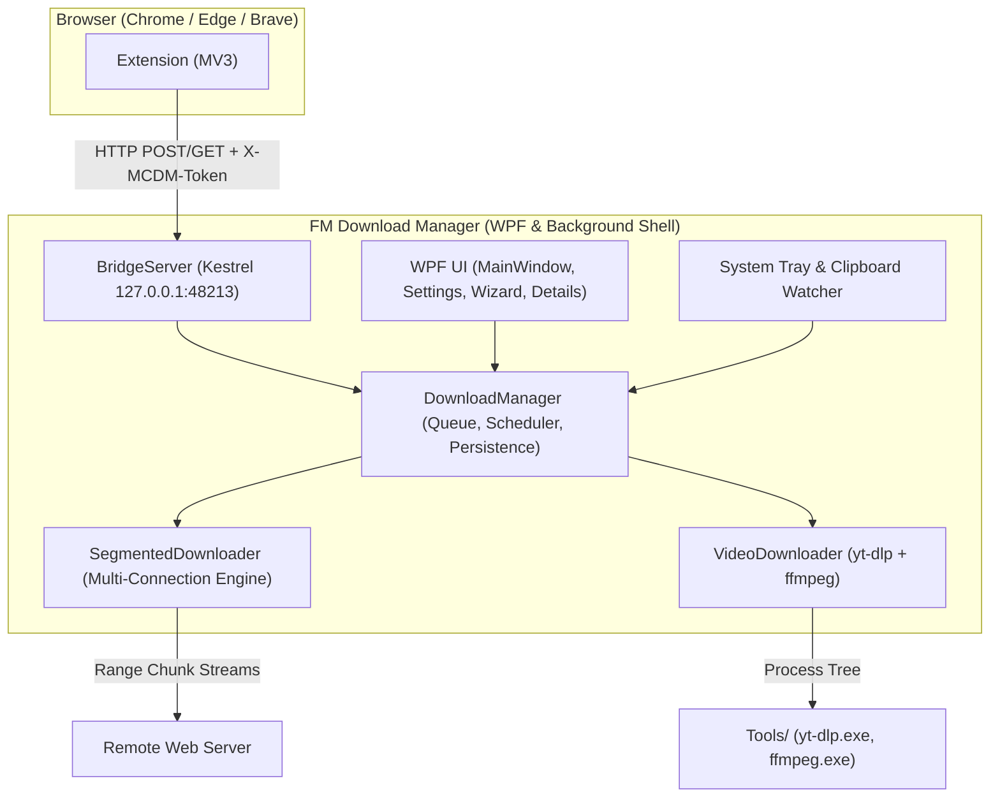

# FM Download Manager (Windows Port)

> Fast, lightweight, multi-connection download manager with browser interception and video downloads for Windows 10/11 (C# / .NET 8).
>
> *(Based on the upstream macOS project [mstcvk/mc-download-manager](https://github.com/mstcvk/mc-download-manager), MIT License).*

---

## Features

- **Multi-Connection Segmented Engine (`McDm.Core`):**
  - Range-based parallel chunk downloads (1–16 connections, default 8).
  - Adaptive connection pool shrinking upon HTTP `429 Too Many Requests` or `503 Service Unavailable`.
  - Pause & resume support via atomic `.mcdm` state persistence.
  - Automatic download restart if server changes `ETag` on resume.
  - Safe redirect tracking (drops cookies when switching hosts).
  - File sanitization, path traversal protection, and automatic collision renaming.
  - Global speed limit throttling (KB/s) via token bucket.
  - Disk free-space check before preallocating disk files.
  - Antivirus lock retry with backoff on completion rename.

- **Browser Integration (Chrome, Edge, Brave):**
  - Intercepts browser downloads and hands them over with session cookies, Referer, and User-Agent.
  - Loopback-only bridge (`127.0.0.1:48213`) secured with **random pairing token** (`X-MCDM-Token`).
  - Supports configurable capture extensions and minimum file size thresholds.
  - First-run **Browser Setup Wizard** with one-click folder opening and pairing code copy.

- **Video Downloads (`yt-dlp` + `FFmpeg`):**
  - Download videos directly from web pages into MP4/MKV with resolution selection up to 4K.
  - Safe child process execution using `ArgumentList` without shell escaping.
  - Real-time progress parsing and cancel/pause support.
  - Built-in `scripts/fetch-tools.ps1` for verified SHA-256 binary downloads.

- **Modern WPF Desktop App (`McDm.App`):**
  - System tray icon with live speed tooltip and completion notifications.
  - Minimize/close to system tray; single-instance activation via named mutex/events.
  - Sidebar categories: *All, Images, Music, Video, Apps, Documents, Archives, Other*.
  - Search filter and IDM-style per-download segment/connection detail viewer.
  - Clipboard monitoring for automatic download prompts.
  - Full Turkish and English localization via `.resx` resources.

---

## Architecture



---

## Bridge API Contract

The local HTTP bridge listens on `127.0.0.1:48213`. Non-loopback Host headers and web origins are strictly rejected with `403 Forbidden`. Every endpoint (except `OPTIONS` and unauthenticated `/ping`) requires the pairing token header:

| Method | Endpoint | Headers Required | Description |
|---|---|---|---|
| `GET` | `/ping` | *(none)* | Returns minimal `{ name, platform, version, paired: false }`. |
| `GET` | `/ping` | `X-MCDM-Token` | Returns full status including `paired: true`, `ytDlpAvailable`, `active`, and settings. |
| `GET` | `/downloads` | `X-MCDM-Token` | Returns recent downloads and their statuses. |
| `POST` | `/download` | `X-MCDM-Token` | Intercepts/adds download (`url`, `fileName`, `referer`, `cookies`, `kind`). |
| `POST` | `/action` | `X-MCDM-Token` | Triggers queue actions: `pause`, `resume`, `cancel`, `remove`. |

---

## Browser Extension Setup & Pairing

1. Start **FM Download Manager**.
2. Click **Browser setup** on the toolbar (or select **Browser extension setup** from settings).
3. Click **Open extension folder in Explorer** to open the `extension/` directory.
4. Open `chrome://extensions` (or `edge://extensions` / `brave://extensions`) in your browser.
5. Enable **Developer mode** and click **Load unpacked**. Select the extension folder.
6. Click the FM Download Manager icon in the browser toolbar.
7. Click **Copy pairing code** in the app and paste it into the extension popup.
8. The extension will display **Paired ✓** and begin intercepting downloads!

---

## Building from Source

### Prerequisites
- Windows 10 (1809+) or Windows 11 (x64)
- .NET 8.0 SDK

### Commands

```powershell
# 1. Restore & Build Release
dotnet build -c Release

# 2. Run All 20 Automated Tests
dotnet run -c Release --project tests/McDm.Tests

# 3. Publish Self-Contained Win-x64 Single File
dotnet publish src/McDm.App/McDm.App.csproj -c Release -r win-x64 --self-contained true -p:PublishSingleFile=true -o publish/win-x64

# 4. Fetch yt-dlp & FFmpeg Tools (Optional for Video Downloads)
powershell -ExecutionPolicy Bypass -File scripts/fetch-tools.ps1

# 5. Compile Inno Setup Installer
& "C:\Users\Ferdi\AppData\Local\Programs\Inno Setup 6\ISCC.exe" installer\setup.iss
```

The compiled installer will be located in `dist/FMDownloadManager-Setup-0.1.0.exe`.

---

## Troubleshooting

- **Port 48213 is already in use:** Ensure no conflicting application or zombie process is holding port 48213 (`netstat -ano | findstr 48213`).
- **Extension shows "Not paired":** Open the app, click **Browser setup**, copy your pairing code, and paste it into the extension popup.
- **SmartScreen warning:** Unsigned binaries built locally or downloaded from GitHub without an EV certificate will display a SmartScreen prompt. Click *More info* -> *Run anyway*.
- **Video downloads say "yt-dlp missing":** Run `scripts/fetch-tools.ps1` to automatically fetch official `yt-dlp.exe` and `ffmpeg.exe` builds into `Tools/`.

---

## Known Limitations

- **Firefox Extension:** Firefox requires signed `.xpi` extensions or `about:debugging` temporary loading in developer editions. Chrome, Edge, and Brave are fully supported out-of-the-box via MV3 unpackaged loading.
