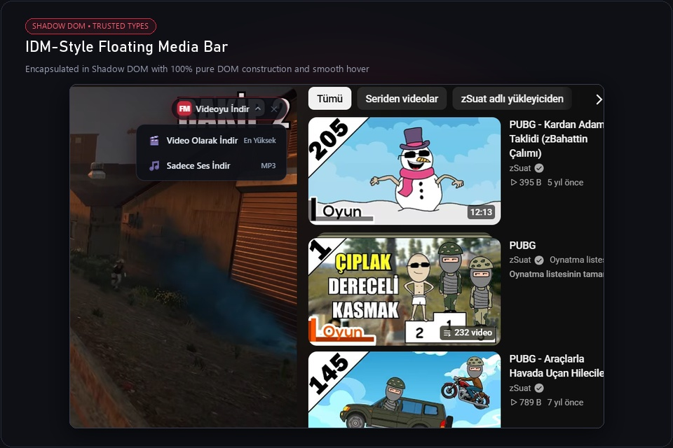
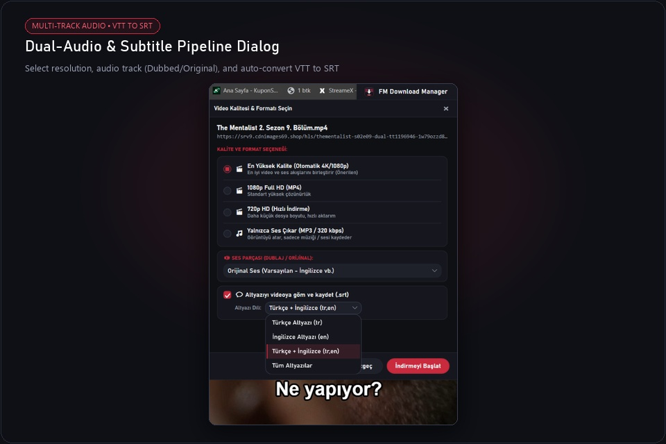
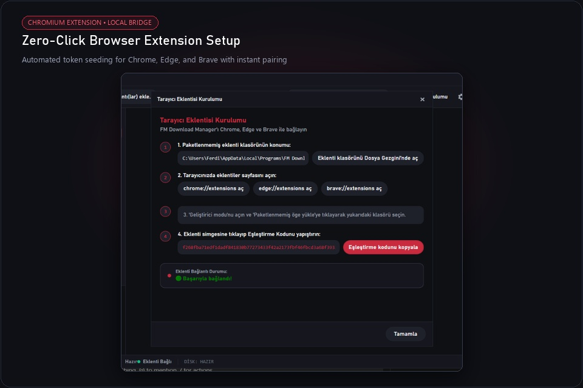
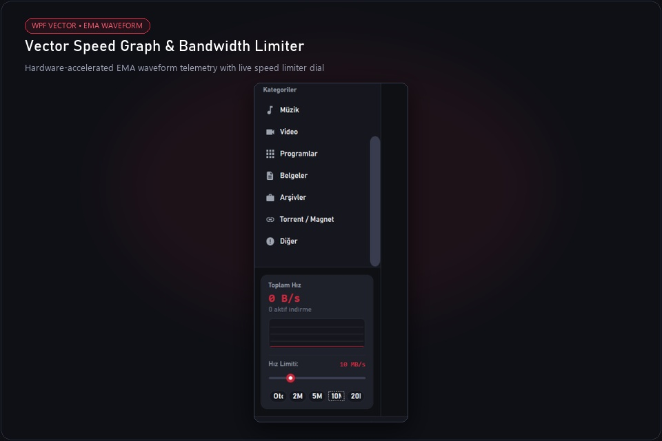
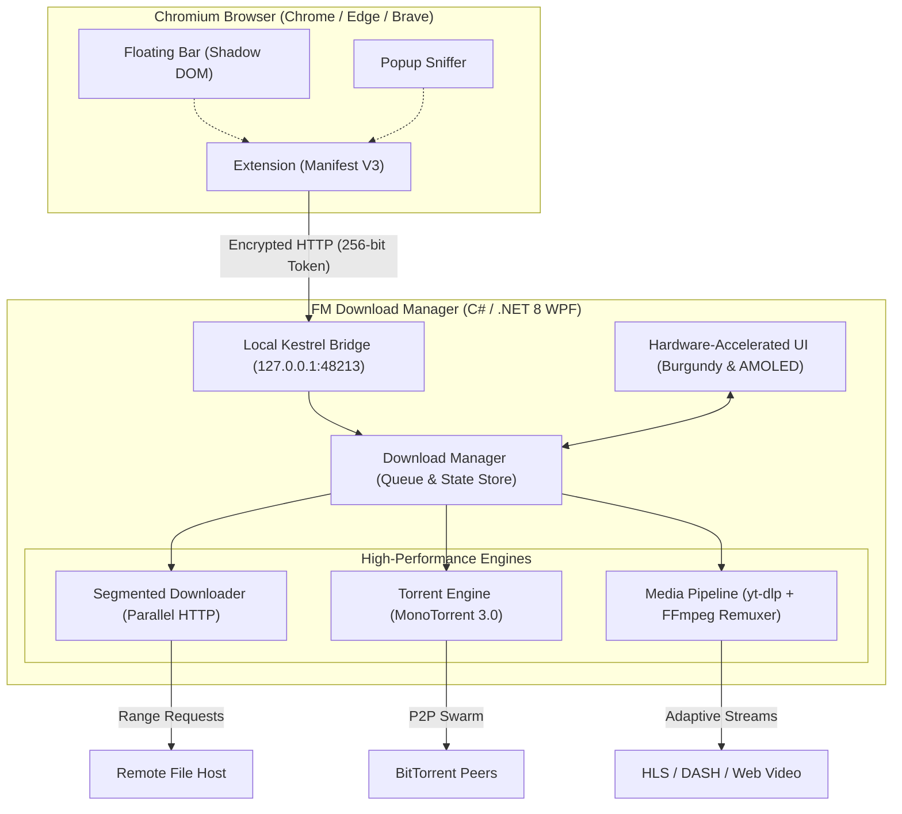

<p align="center">
  <a href="https://github.com/Ferdi-krbk/fm-download-manager">
    
  </a>
</p>

<h1 align="center">FM Download Manager</h1>

<p align="center">
  <b>Ultra-Fast Multi-Threaded Acceleration • Native BitTorrent Client • Universal Media & Dual-Audio Pipeline • IDM-Style Floating Controls</b><br>
  <i>Designed from scratch for Windows 10 &amp; 11 with hardware-accelerated .NET 8 WPF.</i>
</p>

<p align="center">
  <a href="https://github.com/Ferdi-krbk/fm-download-manager/releases/latest"></a>
  <a href="https://dotnet.microsoft.com/download/dotnet/8.0"></a>
  <a href="https://github.com/Ferdi-krbk/fm-download-manager"></a>
  <a href="https://github.com/Ferdi-krbk/fm-download-manager"></a>
  <a href="LICENSE"></a>
  <a href="README.tr.md"></a>
</p>

<p align="center">
  <a href="#-live-showcase">Showcase</a> •
  <a href="#-feature-matrix">Features</a> •
  <a href="#-deep-dive-capabilities">Capabilities</a> •
  <a href="#-architecture">Architecture</a> •
  <a href="#-quickstart--installation">Installation</a> •
  <a href="#-shortcuts">Shortcuts</a>
</p>

---

## 🎬 Live Showcase

<p align="center">
  
</p>

<p align="center">
  <b>⚡ Real-Time Multi-Part Download Engine &amp; Waveform Vector Speed Telemetry in Action</b>
</p>

---

## ✨ Visual Feature Highlights

<table width="100%">
  <tr>
    <td width="50%" valign="top">
      <h3 align="center">🚀 IDM-Style Floating Bar</h3>
      <p align="center">
        
      </p>
      <ul>
        <li><b>Zero-Interference Shadow DOM:</b> Renders isolated from host website styles.</li>
        <li><b>Strict CSP &amp; Trusted-Types Safe:</b> 100% pure DOM node construction (zero <code>innerHTML</code>).</li>
        <li><b>Capture-Phase Hover:</b> Detects mouse movements over embedded players and YouTube videos instantly.</li>
      </ul>
    </td>
    <td width="50%" valign="top">
      <h3 align="center">🎧 Dual-Audio &amp; Subtitle Pipeline</h3>
      <p align="center">
        
      </p>
      <ul>
        <li><b>Dual-Audio Stream Pairing:</b> Auto-muxes video with preferred audio tracks (Dubbed + Original) on 3rd-party players.</li>
        <li><b>Auto VTT ➔ SRT Converter:</b> Cleans timestamps and HTML tags into standard SubRip subtitles.</li>
        <li><b>3 Download Modes:</b> Video + Subtitles, Standalone <code>.srt</code>, or Raw Clean Video.</li>
      </ul>
    </td>
  </tr>
  <tr>
    <td width="50%" valign="top">
      <h3 align="center">🌐 Zero-Click Browser Pairing</h3>
      <p align="center">
        
      </p>
      <ul>
        <li><b>Automated Token Seeding:</b> Unpacks <code>token.json</code> straight to the extension folder.</li>
        <li><b>One-Click Pairing:</b> Turns green instantly without copy-pasting cryptic tokens.</li>
        <li><b>Chromium Universal:</b> Full native support for Google Chrome, Microsoft Edge, and Brave.</li>
      </ul>
    </td>
    <td width="50%" valign="top">
      <h3 align="center">📊 Vector Speed Graph &amp; Limiter</h3>
      <p align="center">
        
      </p>
      <ul>
        <li><b>EMA Filtered Telemetry:</b> Exponential Moving Average eliminates erratic spike noise.</li>
        <li><b>Interactive Speed Dial:</b> Instant preset chips (<code>Auto</code>, <code>2M</code>, <code>5M</code>, <code>10M</code>, <code>20M</code>).</li>
        <li><b>Scheduled Off-Peak Queues:</b> Set automated midnight download windows.</li>
      </ul>
    </td>
  </tr>
</table>

---

## 💎 Feature Matrix

| Feature | FM Download Manager v3.4.3 | Traditional Browsers | Legacy Download Managers |
|---|:---:|:---:|:---:|
| **Dynamic Resegmentation** | ✅ **Active Real-Time Split** | ❌ Single Stream | ⚠️ Fixed segments only |
| **BitTorrent & Magnet Support** | ✅ **Native (MonoTorrent 3.0)** | ❌ None | ❌ Requires separate app |
| **YouTube 4K & MP3 Extraction** | ✅ **Guaranteed MP4 Remux** | ❌ Blocked | ⚠️ Often breaks / WebM only |
| **Dual-Audio Pairing (TR/EN)** | ✅ **Full Video + Audio Mux** | ❌ Downloads audio only | ❌ Corrupt / 19 MB audio file |
| **Universal VTT ➔ SRT Subtitles** | ✅ **3 Modes + VLC Standard** | ❌ None | ❌ None |
| **CSP / Trusted Types Floating Bar** | ✅ **Shadow DOM Safe** | ❌ None | ⚠️ Breaks on modern sites |
| **Zero-Click Browser Pairing** | ✅ **Automated Token Seed** | — | ❌ Manual setup / Ads |
| **Telemetry & Advertising** | 🛡️ **100% Free & Zero Tracking** | ⚠️ High Telemetry | ❌ Adware / Premium Paywalls |

---

## ⚡ Deep-Dive Capabilities

```
┌────────────────────────────────────────────────────────────────────────┐
│  FM DOWNLOAD MANAGER v3.4.3 — UNIVERSAL MEDIA & TURBO PIPELINE        │
├────────────────────────────────────────────────────────────────────────┤
│  ⚡ 1 Gbps Turbo Multi-Part Engine  │  🧲 Native BitTorrent & Magnet   │
│  📊 Vector Waveform EMA Graph       │  🎛️ Bandwidth Limiter Dial       │
│  🎬 YouTube 4K60 / MP3 Remuxer      │  💬 Auto VTT ➔ SRT Subtitles     │
│  🎧 Dual-Audio Stream Pairing       │  🎥 3rd-Party Player Integration │
│  🌐 Zero-Click Extension Pairing    │  ⏱️ Off-Peak Night Scheduler     │
│  🎨 Burgundy & AMOLED Dark Themes   │  🔒 256-Bit Token Security       │
└────────────────────────────────────────────────────────────────────────┘
```

### 1. ⚡ Dynamic Resegmentation Engine
When downloading large files (ISOs, games, archives), fixed multi-part downloaders often suffer from tail latency: if one TCP connection crawls, the entire process waits. 
FM Download Manager monitors byte delivery across all active threads. When an idle connection frees up, it locates the slowest active segment, slices its remaining byte range in two, and downloads the second half in parallel.

### 2. 🧲 Native BitTorrent & Magnet Swarm
No need to install separate heavy torrent clients:
* Magnet links (`magnet:?xt=urn:...`) and `.torrent` files are handled directly inside the queue.
* Built on **MonoTorrent 3.0** with full support for DHT, Peer Exchange (PEX), Local Peer Discovery (LSD), and encrypted peer transfers.

### 3. 🎬 Media Pipeline & Clean MP4 Containers
Integrated with a tuned `yt-dlp` and `FFmpeg` pipeline:
* Single-click extraction from YouTube, Twitter/X, TikTok, Instagram, Reddit, Vimeo, Facebook, and 1000+ sources.
* **Guaranteed MP4 Output:** Automatically remuxes separate DASH video and audio streams into clean, universally playable `.mp4` files (no WebM compatibility headaches).
* **Format Dialog:** Pick between *Ultra Quality (4K60 / 1080p60)*, *720p HD*, or extract *Audio Only (MP3 / 320 kbps)*.

### 4. 🎧 Dual-Audio & Multi-Track Pairing
Modern web video players deliver adaptive HLS (`.m3u8`) or DASH (`.mpd`) streams containing multiple audio channels (e.g., Dubbed + Original languages).
* **The Problem:** Standard tools often download only the first isolated audio stream (~20 MB) leaving you with a blank audio file.
* **The Solution:** FM Download Manager pairs the requested resolution with the selected audio track, remuxing both into an intact ~700 MB - 2 GB full-length MP4 video.

### 5. 💬 Universal Subtitle Extractor & VTT ➔ SRT Converter
* **3 Flexible Modes:**
  1. *Video + Subtitles:* Embeds or downloads the subtitle track alongside the video.
  2. *Subtitles Only (`.srt`):* Grabs the subtitle file in seconds without downloading video bytes.
  3. *Raw Clean Video:* Fetches video without subtitle data.
* **Automatic Normalization:** Web players serve raw WebVTT with timing artifacts. FM Download Manager converts them on the fly to standard SubRip (`.srt`) compatible with VLC, Smart TVs, and mobile players.

### 6. 🚀 Modern Shadow DOM Floating Bar
* Injected into pages via an encapsulated Shadow DOM barrier, immune to website stylesheet conflicts.
* Engineered with pure DOM node construction, satisfying strict Content Security Policies (CSP) and Trusted Types on modern platforms.
* Smooth capture-phase hover activation over video elements and embedded player iframes.

---

## 🏗️ Architecture



---

## 📦 Quickstart & Installation

### Option 1: Standalone Windows Installer (Recommended)
1. Grab the latest installer: [FMDownloadManager-Setup-3.4.3.exe](https://github.com/Ferdi-krbk/fm-download-manager/releases/download/v3.4.3/FMDownloadManager-Setup-3.4.3.exe).
2. Run the setup (installs to `%LOCALAPPDATA%\Programs\FM Download Manager` without admin privileges).
3. The setup automatically unpacks the companion browser extension and opens the quick setup guide.

### Option 2: Browser Extension Setup
1. In Chrome, Edge, or Brave, open `chrome://extensions`.
2. Enable **Developer Mode** (top-right toggle).
3. Click **Load unpacked** and choose the `extension` folder inside the installation directory.
4. The extension automatically reads the local security key (`token.json`) and pairs with a green indicator!

---

## ⌨️ Keyboard Shortcuts

| Shortcut | Action |
|---|---|
| `Ctrl + N` | Add new download (Direct link, Video URL, or Magnet URI) |
| `Ctrl + V` | Automatically paste URL from clipboard |
| `Ctrl + F` | Focus instant search & filter box |
| `Space` | Pause or Resume selected download |
| `Delete` | Remove task from queue |
| `Shift + Delete` | Remove task and permanently delete file from disk |
| `Ctrl + Shift + T` | Toggle between Dark Burgundy and Deep AMOLED Black themes |
| `Ctrl + ,` | Open Preferences dialog |

---

## 🛠️ Building from Source

```bash
# 1. Clone the repository
git clone https://github.com/Ferdi-krbk/fm-download-manager.git
cd fm-download-manager

# 2. Restore & build solution
dotnet restore
dotnet build -c Release

# 3. Run full automated test suite (68 tests)
node tests/test_full_download_matrix.js
dotnet test tests/McDm.Tests/McDm.Tests.csproj

# 4. Launch application
dotnet run --project src/McDm.App/McDm.App.csproj
```

---

## 📄 License & Credits

* **License:** Distributed under the open-source [MIT License](LICENSE).
* **Upstream Heritage:** Inspired by the macOS open-source project [MC Download Manager](https://github.com/mstcvk/mc-download-manager) by [Mesut Çevik](https://github.com/mstcvk). Fully rewritten and customized for modern Windows 10 & 11.
* **Core Technologies:** Built with [.NET 8](https://github.com/dotnet), [MonoTorrent](https://github.com/alanmcgovern/monotorrent), [yt-dlp](https://github.com/yt-dlp/yt-dlp), and [FFmpeg](https://ffmpeg.org/).
