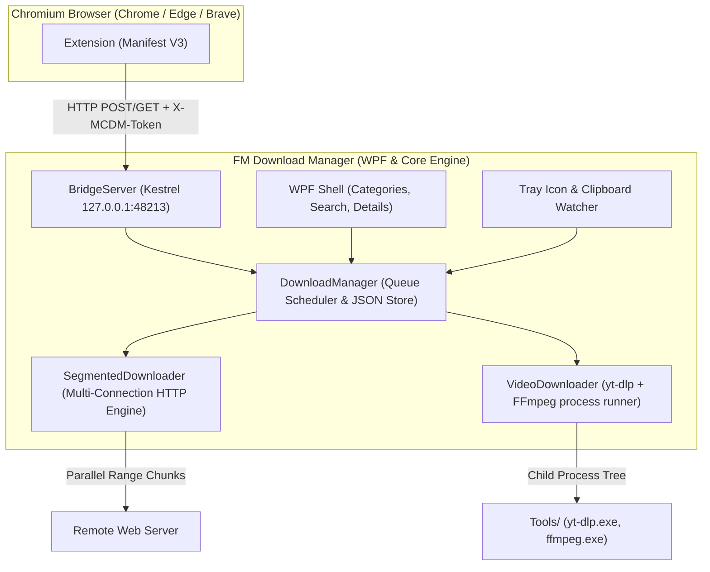

<p align="center">
  
</p>

<h1 align="center">FM Download Manager</h1>

<p align="center">
  <b>High-speed, multi-connection download manager with smart browser interception & 4K video downloader for Windows 10 & 11.</b><br>
  <i>(A full Windows port of <a href="https://github.com/mstcvk">Mesut Çevik</a>'s open-source macOS <a href="https://github.com/mstcvk/mc-download-manager">MC Download Manager</a> project).</i>
</p>

<p align="center">
  <a href="https://github.com/Ferdi-krbk/fm-download-manager/releases"></a>
  <a href="https://dotnet.microsoft.com/download/dotnet/8.0"></a>
  <a href="LICENSE"></a>
  <a href="README.tr.md"></a>
</p>

<p align="center">
  <a href="#features">Features</a> •
  <a href="#architecture">Architecture</a> •
  <a href="#browser-integration">Browser Integration</a> •
  <a href="#video-downloads">Video Downloads</a> •
  <a href="#installation--setup">Installation</a> •
  <a href="#building-from-source">Build from Source</a> •
  <a href="#troubleshooting">Troubleshooting</a>
</p>

---

## ⚡ Highlights

- 🚀 **Maximized Bandwidth:** Multi-connection segmented engine (up to 16 parallel threads per file).
- 🌐 **Seamless Interception:** Intercepts browser downloads in **Chrome, Edge, and Brave** with session cookies, headers, and credentials.
- 🎬 **Video Downloader:** One-click YouTube/web video downloader powered by `yt-dlp` and `FFmpeg` (up to 4K MP4/MKV).
- 🛡️ **Zero-Crash Resilience:** Automatic pause/resume via atomic `.mcdm` state, ETag change recovery, and network change auto-healing.
- 🎨 **Modern Native UI:** Fast, lightweight WPF client with system tray integration, categorized views, clipboard listener, and connection visualizer.
- 🔒 **Zero Telemetry & Local Only:** Local HTTP bridge secured by 256-bit pairing token (`X-MCDM-Token`). No cloud dependencies.

---

## 📸 Overview & Features

### 🗂️ Smart Sidebar Categorization & Search
Organizes downloads by file type automatically (*All, Images, Music, Video, Apps, Documents, Archives, Other*) with real-time text filtering and sortable columns.

### 📊 Connection Visualizer (IDM-Style)
Inspect individual chunk byte-ranges, per-segment transfer speeds, and active thread counts in real time.

```
┌────────────────────────────────────────────────────────────────────────┐
│  Download: archive-backup.zip (2.4 GB)                                 │
├────────────────────────────────────────────────────────────────────────┤
│  [=====================================>         ] 78% (18.4 MB/s)     │
│                                                                        │
│  Segment 1:  [====================] 100% (300 MB / 300 MB)             │
│  Segment 2:  [====================] 100% (300 MB / 300 MB)             │
│  Segment 3:  [==============>     ]  72% (216 MB / 300 MB)             │
│  Segment 4:  [===========>        ]  55% (165 MB / 300 MB)             │
└────────────────────────────────────────────────────────────────────────┘
```

### 📋 Clipboard Auto-Detection
Whenever an `http(s)` download link to a file is copied to your clipboard, FM Download Manager pops up a non-intrusive prompt asking if you'd like to capture it.

### 🌐 System Tray Integration
- Minimizes directly to tray when closing the window.
- Real-time download speed and active transfer count shown in tray tooltip.
- Native balloon notifications upon download completion.

---

## 🏗️ Architecture



---

## 🔌 Browser Integration & Pairing Flow

FM Download Manager includes an unpacked Manifest V3 browser extension for **Google Chrome, Microsoft Edge, and Brave**.

```
  1. Open FM Download Manager
       ↓
  2. Click "Browser setup" on toolbar
       ↓
  3. Click "Open folder" → Copies extension location
       ↓
  4. In Browser: Extensions (chrome://extensions) → Enable "Developer mode" → "Load unpacked"
       ↓
  5. Click Extension Icon in toolbar → Paste Pairing Token → Done (✓ Paired)
```

### Bridge Security Contract
- **Loopback Enforced:** Listens exclusively on `127.0.0.1:48213`.
- **Origin Validation:** Strictly refuses external web page origins or `null` origins with `403 Forbidden`.
- **Token Protection:** Every bridge request requires the secret `X-MCDM-Token` generated per user under `%LOCALAPPDATA%\MC Download Manager\bridge.token`.

| Method | Endpoint | Required Headers | Description |
|---|---|---|---|
| `GET` | `/ping` | *(none)* | Returns basic state `{ name, platform, version, paired: false }`. |
| `GET` | `/ping` | `X-MCDM-Token` | Returns full status: `paired: true`, `ytDlpAvailable`, download count. |
| `GET` | `/downloads`| `X-MCDM-Token` | Returns list of recent downloads with real-time status. |
| `POST`| `/download` | `X-MCDM-Token` | Intercepts download with cookies, referer & user-agent. |
| `POST`| `/action`   | `X-MCDM-Token` | Controls downloads (`pause`, `resume`, `cancel`, `remove`). |

---

## 📥 Installation

### Method 1: Ready Installer (Recommended)
Download the latest `FMDownloadManager-Setup-2.0.0.exe` from [GitHub Releases](https://github.com/Ferdi-krbk/fm-download-manager/releases).
- Installs to `%LOCALAPPDATA%\Programs\FM Download Manager` (no admin rights required).
- Automatically configures desktop and start menu shortcuts.

### Method 2: Portable / Standalone
Download the self-contained single-file `.exe` and run directly.

---

## 🛠️ Building from Source

### Prerequisites
- Windows 10 (1809+) or Windows 11 (x64)
- [.NET 8.0 SDK](https://dotnet.microsoft.com/download/dotnet/8.0)
- Inno Setup 6 (optional, for installer creation)

### Commands

```powershell
# Clone the repository
git clone https://github.com/Ferdi-krbk/fm-download-manager.git
cd fm-download-manager

# Build Solution
dotnet build -c Release

# Run automated tests (20 end-to-end tests)
dotnet run -c Release --project tests/McDm.Tests

# Publish self-contained single-file executable
dotnet publish src/McDm.App/McDm.App.csproj -c Release -r win-x64 --self-contained true -p:PublishSingleFile=true -o publish/win-x64

# (Optional) Download official yt-dlp & FFmpeg binaries
powershell -ExecutionPolicy Bypass -File scripts/fetch-tools.ps1

# (Optional) Compile Inno Setup installer (if Inno Setup 6 is installed)
iscc installer\setup.iss
```

---

## ⚙️ Settings & Customization

| Setting | Default | Description |
|---|---|---|
| **Download Folder** | `~/Downloads` | Default destination directory for downloaded files. |
| **Connections** | `8` | Parallel Range threads per download (1 to 16). |
| **Max Concurrent** | `3` | Maximum number of simultaneously downloading tasks. |
| **Speed Limit** | `0` (Unlimited) | Global throttling cap in KB/s. |
| **Min Intercept Size**| `5 MB` | Browser downloads smaller than this won't be captured. |
| **Start with Windows**| `Disabled` | Adds background tray launch on Windows startup (`--background`). |
| **Language** | `Auto` | Select between English and Turkish (Türkçe). |

---

## 📄 License & Attribution

- Released under the **MIT License**.
- Based on the upstream macOS project [mstcvk/mc-download-manager](https://github.com/mstcvk/mc-download-manager).
- Bundled third-party tools (FFmpeg & yt-dlp) are governed by their respective licenses (LGPL/GPL & Unlicense). See [NOTICE.md](NOTICE.md) for full attribution details.
