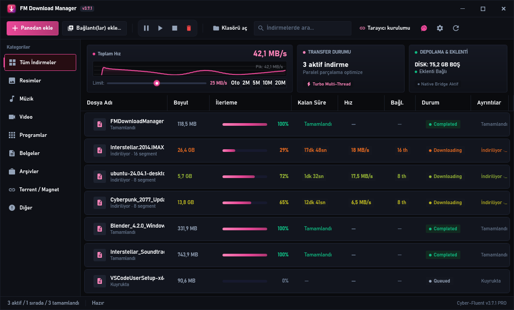
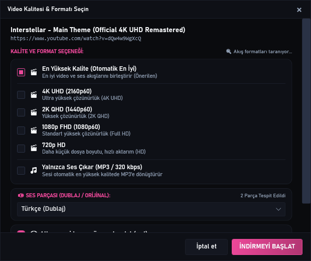
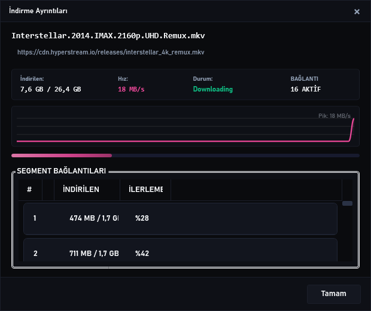
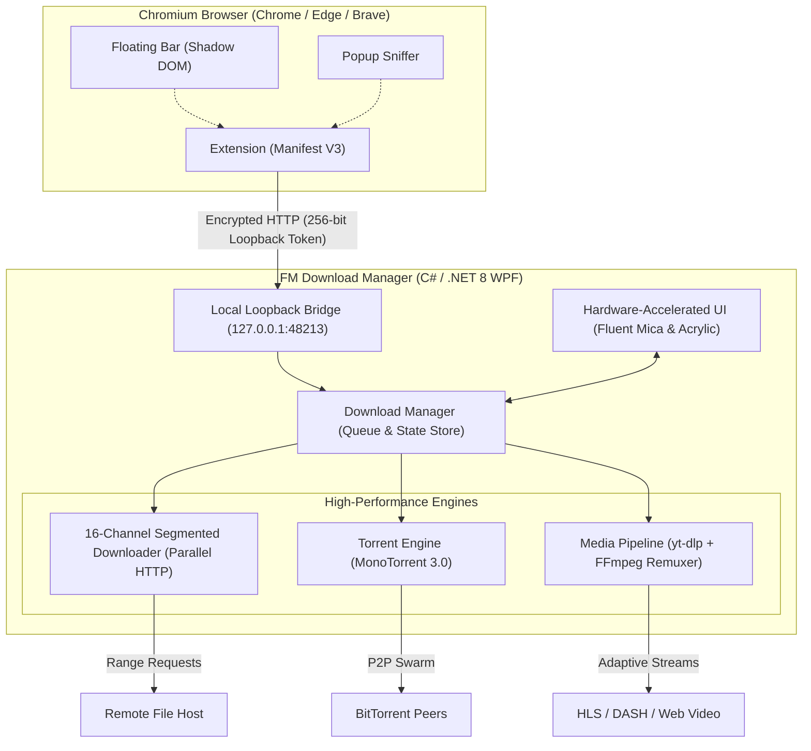

<p align="center">
  <a href="https://github.com/Ferdi-krbk/fm-download-manager">
    
  </a>
</p>

<h1 align="center">FM Download Manager</h1>

<p align="center">
  <b>The Ultimate Next-Generation Download Accelerator for Windows 10 &amp; 11</b><br>
  <i>16-Channel Dynamic Parallel Acceleration • IDM-Style Browser Floating Video Bar • Universal 4K &amp; Dual-Audio Pipeline • Native BitTorrent Client • Fluent Mica Glassmorphic UI</i>
</p>

<p align="center">
  <a href="https://github.com/Ferdi-krbk/fm-download-manager/releases/latest"></a>
  <a href="https://dotnet.microsoft.com/download/dotnet/8.0"></a>
  <a href="https://github.com/Ferdi-krbk/fm-download-manager"></a>
  <a href="https://github.com/Ferdi-krbk/fm-download-manager"></a>
  <a href="LICENSE"></a>
  <a href="README.tr.md"></a>
</p>

<p align="center">
  <a href="https://github.com/Ferdi-krbk/fm-download-manager/releases/download/v3.7.1/FMDownloadManager-Setup-3.7.1.exe">
    
  </a>
  <a href="https://ferdi-krbk.github.io/fm-download-manager/" target="_blank">
    
  </a>
</p>

<p align="center">
  <a href="#-why-fm-download-manager">Why FM?</a> •
  <a href="#-visual-tour--screenshots">Screenshots</a> •
  <a href="#-feature-matrix">Feature Matrix</a> •
  <a href="#-core-capabilities">Capabilities</a> •
  <a href="#-architecture">Architecture</a> •
  <a href="#-quickstart--installation">Installation</a> •
  <a href="#-keyboard-shortcuts">Shortcuts</a>
</p>

---

## ⚡ Live Showcase

<p align="center">
  
</p>

<p align="center">
  <b>⚡ 16-Channel Resegmentation &amp; Waveform Vector Speed Telemetry in Action</b><br>
  <a href="https://ferdi-krbk.github.io/fm-download-manager/" target="_blank"><b>👉 Click here to experience the Live Interactive Web Showcase</b></a>
</p>

---

## 💡 Why FM Download Manager?

Most desktop download managers available today are stuck in the mid-2000s:
- **Outdated, Cluttered Interfaces:** Unresponsive 90s-style win32 chrome, non-DPI-aware fonts, and glaring white backgrounds.
- **Nag Screens & Paywalls:** Constant trial expirations, intrusive licensing popups, and risky crack/patch executables.
- **Broken Media Pipelines:** Grabbing 19 MB audio-only files instead of movies, failing on adaptive HLS/DASH streams, and corrupting foreign language subtitles.
- **Invasive Adware & Bundled Bloat:** Hidden background telemetries, search engine hijacking, and unwanted toolbar installers.

**FM Download Manager was engineered from scratch to fix this:**
1. **Windows 11 Native Fluent Mica & Dark Acrylic Design:** Gorgeous burgundy/crimson aesthetic with silky smooth WPF animations, dynamic palette switching, and high-DPI crystal clarity.
2. **16-Channel Dynamic Multi-Thread Engine:** Slices large files across up to 16 simultaneous HTTP connections, dynamically repartitioning slow chunks in real time to max out your gigabit bandwidth.
3. **Universal Media & Dual-Audio Intelligence:** Flawlessly detects YouTube, Twitter, TikTok, and web streaming videos. Muxes chosen audio tracks (Turkish Dubbing, Original, etc.) and auto-converts messy WebVTT into clean SubRip (`.srt`) subtitles.
4. **Native BitTorrent Swarm Client:** Direct Magnet URI and `.torrent` handling powered by MonoTorrent 3.0—no second client required.
5. **100% Free & Open Source:** Zero ads, zero tracking, zero telemetry, released under the permissive MIT license.

---

## 📸 Visual Tour & Screenshots

<table width="100%">
  <tr>
    <td width="50%" valign="top">
      <h3 align="center">🖥️ Fluent Dark Acrylic Dashboard</h3>
      <p align="center">
        
      </p>
      <ul>
        <li><b>16-Thread Live Segment Bars:</b> Visual IDM-style progress indicator tracking active byte chunks in real time.</li>
        <li><b>Vector EMA Speed Waveform:</b> Exponential Moving Average filtered telemetry rendering butter-smooth bandwidth graphs.</li>
        <li><b>Smart Drag &amp; Drop:</b> Drag links, `.torrent` files, or URLs directly into the window.</li>
      </ul>
    </td>
    <td width="50%" valign="top">
      <h3 align="center">🎬 Universal Video &amp; Subtitle Sniffer</h3>
      <p align="center">
        
      </p>
      <ul>
        <li><b>Single-Click 4K / 1080p / MP3:</b> Instant quality selection with thumbnail and video duration preview.</li>
        <li><b>Dual-Audio Stream Muxer:</b> Select Turkish Dubbing, Original audio, or multiple tracks combined via FFmpeg.</li>
        <li><b>Subtitle Converter:</b> Automatically converts WebVTT to standard SubRip (`.srt`) for VLC and Smart TVs.</li>
      </ul>
    </td>
  </tr>
  <tr>
    <td width="50%" valign="top">
      <h3 align="center">🎨 Live Accent Palette &amp; Sync</h3>
      <p align="center">
        
      </p>
      <ul>
        <li><b>5 Signature Color Themes:</b> Hyper Crimson, Emerald Green, Amber Gold, Sapphire Blue, and Electric Violet.</li>
        <li><b>Instant Extension Sync:</b> Changing the desktop palette or language dynamically updates the browser extension in real time.</li>
        <li><b>AMOLED &amp; Dark Burgundy:</b> Ultra-deep contrast modes tailored for OLED displays.</li>
      </ul>
    </td>
    <td width="50%" valign="top">
      <h3 align="center">⚡ 16-Segment Multi-Thread Inspector</h3>
      <p align="center">
        
      </p>
      <ul>
        <li><b>Granular Thread Telemetry:</b> Monitor every active HTTP chunk, byte range, and completion percentage in real time.</li>
        <li><b>IDM-Style Visual Chunking:</b> Inspect how large files are partitioned across up to 16 parallel TCP sockets.</li>
        <li><b>Dynamic Resegmentation:</b> Automatically splits and reassigns lagging connections to saturate bandwidth.</li>
      </ul>
    </td>
  </tr>
</table>

---

## 💎 Feature Matrix

| Feature | FM Download Manager v3.7.1 | Traditional Browsers | Legacy Download Managers (IDM / FDM) |
|---|:---:|:---:|:---:|
| **Modern Windows 11 UI** | ✅ **Fluent Dark Mica & Glassmorphism** | ⚠️ Basic flat UI | ❌ 90s-era Win32 winbox interface |
| **Dynamic Resegmentation** | ✅ **16-Channel Real-Time Split** | ❌ Single TCP stream | ⚠️ Fixed segments only |
| **BitTorrent & Magnet Swarm** | ✅ **Native (MonoTorrent 3.0)** | ❌ None | ❌ Requires separate torrent client |
| **YouTube 4K & Clean MP4** | ✅ **Guaranteed MP4 Remux** | ❌ Blocked | ⚠️ Often breaks / WebM only |
| **Dual-Audio Pairing (TR/EN)** | ✅ **Full Video + Dubbing Mux** | ❌ Downloads audio only | ❌ Corrupt / 19 MB blank audio file |
| **Universal VTT ➔ SRT Converter** | ✅ **Automatic SubRip Normalization** | ❌ None | ❌ None |
| **Floating Video Bar** | ✅ **Shadow DOM & CSP Safe** | ❌ None | ⚠️ Breaks on modern web players |
| **Filename & Extension Safety** | ✅ **100% Guaranteed Preservation** | ⚠️ Unreliable | ⚠️ Truncates on query params |
| **Smart Network Recovery** | ✅ **Auto-Reconnect & Drop Resume** | ❌ Download fails | ⚠️ Often requires manual restart |
| **Pricing & Telemetry** | 🛡️ **100% Free & Open Source (MIT)** | ⚠️ Heavy Telemetry | ❌ Commercial paywalls / Adware |

---

## 🚀 Core Capabilities

```
┌────────────────────────────────────────────────────────────────────────┐
│  FM DOWNLOAD MANAGER v3.7.1 — TURBO PIPELINE ARCHITECTURE              │
├────────────────────────────────────────────────────────────────────────┤
│  ⚡ 16-Channel Resegmentation Engine │  🧲 Native BitTorrent & Magnet   │
│  📊 Vector Waveform EMA Graph        │  🎛️ Bandwidth Limiter Dial       │
│  🎬 YouTube 4K60 / MP3 Remuxer       │  💬 Auto VTT ➔ SRT Subtitles     │
│  🎧 Dual-Audio Stream Pairing        │  🔄 Network Recovery & Auto-Retry│
│  🌐 Zero-Click Extension Pairing     │  ⏱️ Off-Peak Night Scheduler     │
│  🎨 Dynamic Palette & Sync           │  🔒 256-Bit Token Security       │
└────────────────────────────────────────────────────────────────────────┘
```

### 1. ⚡ 16-Channel Dynamic Resegmentation
When downloading large files (ISOs, game installers, archives), static multi-part downloaders often suffer from connection bottlenecks: if one connection stalls, your overall download speed tanks.
- **Adaptive Chunk Slicing:** FM Download Manager continuously monitors byte delivery throughput across all 16 parallel threads.
- **Dynamic Slicing:** When a connection finishes its workload early, it pinpoints the slowest active thread, divides its remaining byte range in two, and downloads the remaining half in parallel.

### 2. 🛡️ 100% Filename & Extension Protection
Never lose file associations again:
- **Authoritative Server Probing:** Respects remote server `Content-Disposition` headers and URL filenames.
- **Extension Guarantee:** Even if a browser sends an extensionless title, FM Download Manager verifies and appends the server's true extension (`.exe`, `.zip`, `.pdf`, `.iso`, etc.), ensuring files are 100% ready to use.

### 3. 🎬 YouTube 4K & Universal Web Media Pipeline
Seamlessly integrated with a tuned `yt-dlp` and `FFmpeg` pipeline:
- **1000+ Supported Sites:** Single-click capture from YouTube, Twitter/X, TikTok, Instagram, Reddit, Vimeo, Facebook, and streaming portals.
- **Guaranteed MP4 Output:** Automatically remuxes separate DASH video and audio streams into clean, universally playable `.mp4` containers (no WebM compatibility headaches).
- **Format Sniffer Dialog:** Pick between *Ultra Quality (4K60 / 1080p60)*, *720p HD*, or extract *Audio Only (MP3 / 320 kbps)*.

### 4. 🎧 Multi-Language Audio & Dubbing Pairing
Modern web video platforms distribute adaptive HLS (`.m3u8`) or DASH (`.mpd`) streams containing multiple separated audio tracks (e.g., Turkish Dubbed + Original English):
- **The Problem:** Standard download tools typically capture only the first separated audio stream (~19 MB), resulting in an unplayable audio-only file.
- **The Solution:** FM Download Manager identifies both streams, extracts your selected audio track, and remuxes them into a complete, full-length ~1-2 GB MP4 movie.

### 5. 💬 Automatic VTT ➔ SubRip (`.srt`) Subtitle Converter
- **3 Flexible Modes:**
  1. *Video + Subtitles:* Downloads and embeds the subtitle track into the MP4 container.
  2. *Subtitles Only (`.srt`):* Grabs the subtitle file in seconds without downloading video bytes.
  3. *Raw Clean Video:* Fetches video without subtitle data.
- **Automatic Clean-Up:** Normalizes timing artifacts, cue tags, and HTML styling into standard SubRip (`.srt`) compatible with VLC, MPC-HC, Smart TVs, and mobile players.

### 6. 🧲 Native BitTorrent & Magnet Swarm
No need to run separate, memory-hungry torrent software:
- Magnet links (`magnet:?xt=urn:...`) and `.torrent` files are handled directly inside the download queue.
- Built on **MonoTorrent 3.0** with full support for DHT, Peer Exchange (PEX), Local Peer Discovery (LSD), and encrypted peer transfers.

### 7. 🔄 Smart Network Auto-Reconnect & Drop Recovery
- Transient WiFi drops, ISP reconnects, or brief router restarts no longer ruin hours of downloading.
- The manager automatically detects link loss, pauses the state safely, backs off exponentially, and resumes all segments seamlessly once internet connectivity is restored.

---

## 🏗️ Architecture



---

## 📦 Quickstart & Installation

### Option 1: Standalone Windows Installer (Recommended)
1. Download the latest installer: [**FMDownloadManager-Setup-3.7.1.exe**](https://github.com/Ferdi-krbk/fm-download-manager/releases/download/v3.7.1/FMDownloadManager-Setup-3.7.1.exe).
2. Run the setup (installs locally to `%LOCALAPPDATA%\Programs\FM Download Manager` without requiring administrator privileges).
3. The setup automatically unpacks the companion browser extension and displays the quick setup guide.

### Option 2: Companion Browser Extension Setup
> [!TIP]
> **Always load the extension directly from the installed program folder!**
> This ensures that whenever FM Download Manager updates, your browser extension updates automatically with zero manual effort!

1. In Google Chrome, Microsoft Edge, or Brave, navigate to: `chrome://extensions`
2. Turn ON **Developer Mode** (toggle in the top-right corner).
3. Click **Load unpacked** (*Paketlenmemiş öge yükle*).
4. Select the extension folder directly from your installation:
   ```
   %LOCALAPPDATA%\Programs\FM Download Manager\extension
   ```
   *(Press <kbd>Win</kbd> + <kbd>R</kbd>, paste `%LOCALAPPDATA%\Programs\FM Download Manager\extension`, and click Select Folder)*.
5. The extension will automatically read `token.json` and pair with a glowing green indicator!

---

## ⌨️ Keyboard Shortcuts

| Shortcut | Action |
|---|---|
| <kbd>Ctrl</kbd> + <kbd>N</kbd> | Add new download (Direct link, Video URL, or Magnet URI) |
| <kbd>Ctrl</kbd> + <kbd>V</kbd> | Paste URL directly from clipboard |
| <kbd>Ctrl</kbd> + <kbd>F</kbd> | Focus instant search & category filter |
| <kbd>Space</kbd> | Pause or Resume selected download |
| <kbd>Delete</kbd> | Remove task from queue |
| <kbd>Shift</kbd> + <kbd>Delete</kbd> | Remove task and permanently delete file from disk |
| <kbd>Ctrl</kbd> + <kbd>Shift</kbd> + <kbd>T</kbd> | Toggle between Dark Burgundy and Deep AMOLED themes |
| <kbd>Ctrl</kbd> + <kbd>,</kbd> | Open Preferences dialog |

---

## 🛠️ Building from Source

Requirements:
- Windows 10/11 x64
- [.NET 8.0 SDK](https://dotnet.microsoft.com/download/dotnet/8.0)
- Inno Setup 6 (optional, for installer creation)

```bash
# 1. Clone repository
git clone https://github.com/Ferdi-krbk/fm-download-manager.git
cd fm-download-manager

# 2. Restore and compile solution
dotnet restore
dotnet build -c Release

# 3. Publish self-contained executable
dotnet publish src/McDm.App/McDm.App.csproj -c Release -r win-x64 --self-contained true -p:PublishSingleFile=true -o publish/win-x64

# 4. Run application
./publish/win-x64/FMDownloadManager.exe
```

---

## 📄 License & Credits

* **License:** Distributed under the open-source [MIT License](LICENSE).
* **Upstream Heritage:** Inspired by the macOS open-source project [MC Download Manager](https://github.com/mstcvk/mc-download-manager) by [Mesut Çevik](https://github.com/mstcvk). Completely re-architected, custom-styled, and built for modern Windows 10 & 11.
* **Core Technologies:** Built with [.NET 8](https://github.com/dotnet), [MonoTorrent](https://github.com/alanmcgovern/monotorrent), [yt-dlp](https://github.com/yt-dlp/yt-dlp), and [FFmpeg](https://ffmpeg.org/).

<p align="center">
  <sub>Crafted with passion for high performance and modern Windows aesthetics.</sub>
</p>
