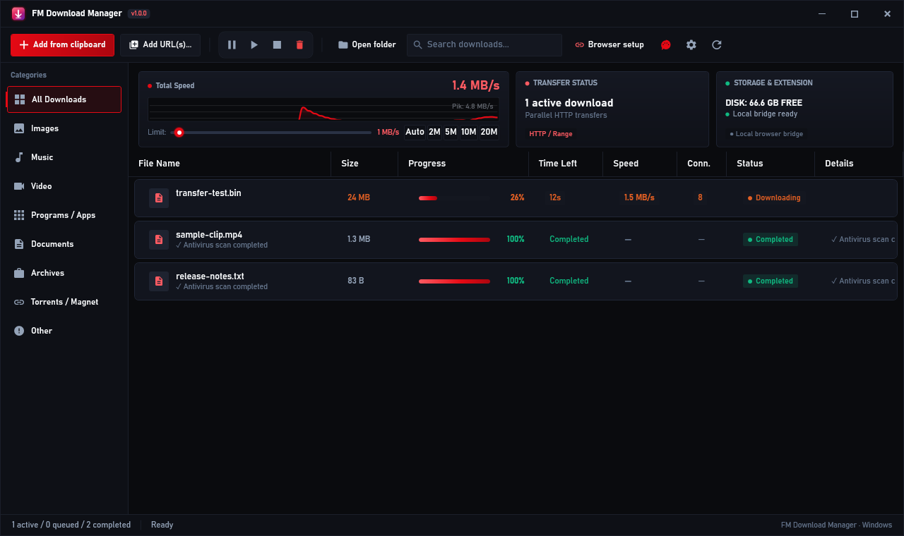
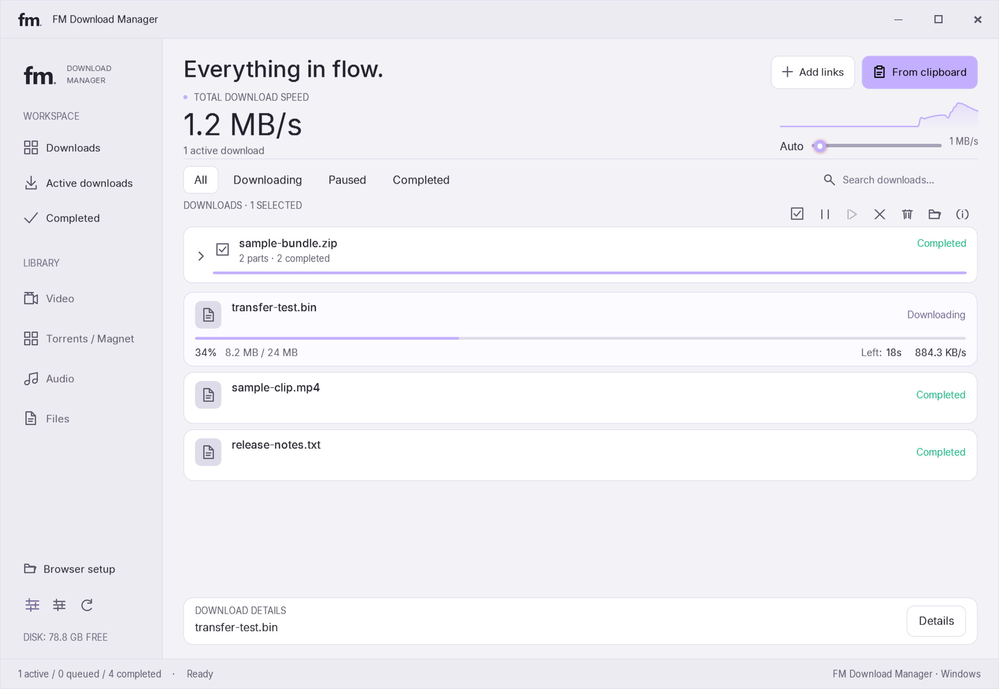
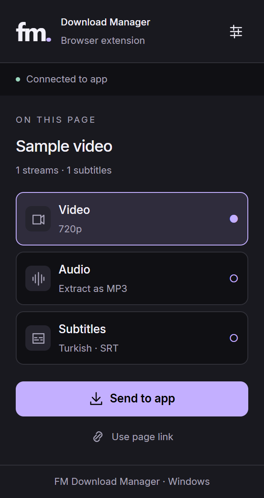
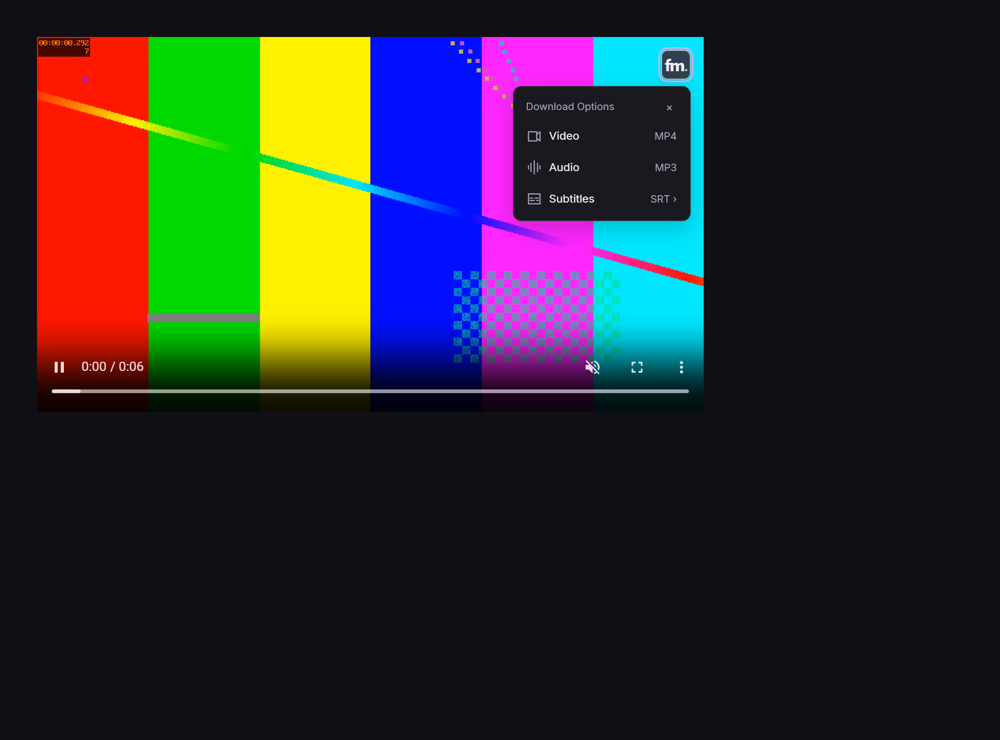
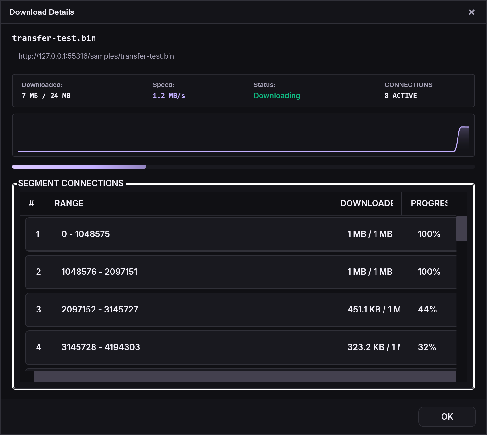

<p align="center">
  
</p>

<h1 align="center">FM Download Manager</h1>

<p align="center">Files, media and torrents. One Windows desktop app.</p>

<p align="center">
  <a href="https://github.com/Ferdi-krbk/fm-download-manager/releases/tag/v1.0.0"></a>
  <a href="https://github.com/Ferdi-krbk/fm-download-manager/actions/workflows/build.yml"></a>
  
  <a href="LICENSE"></a>
</p>

<p align="center">
  <a href="https://github.com/Ferdi-krbk/fm-download-manager/releases/download/v1.0.0/FMDownloadManager-Setup-1.0.0.exe"><strong>Download for Windows x64</strong></a>
  &nbsp;·&nbsp; <a href="README.tr.md">Türkçe</a>
  &nbsp;·&nbsp; <a href="https://ferdi-krbk.github.io/fm-download-manager/">Overview</a>
  &nbsp;·&nbsp; <a href="https://github.com/Ferdi-krbk/fm-download-manager/issues">Report an issue</a>
</p>

<picture>
  <source media="(prefers-color-scheme: light)" srcset="docs/screenshots/downloads-light.png">
  
</picture>

<p align="center"><sub>Current 1.0.0 WPF interface, rendered with real isolated test downloads. Transfer progress and speeds are not simulated.</sub></p>

## What it does

| Area | Capabilities |
| --- | --- |
| File downloads | Parallel HTTP connections, queue controls, speed limits and resumable transfers when the server supplies a reliable validator. |
| Media | yt-dlp and FFmpeg integration for supported video sites, HLS/DASH streams, audio extraction and available subtitle tracks. |
| Torrents | Magnet links and `.torrent` files through MonoTorrent, with pause/resume and a download speed limit. |
| Multipart archives | Numbered archive volumes share an expandable group with aggregate progress and batch selection. Files stay separate on disk. |
| Browser integration | A Chromium extension for file handoff, media detection and a compact fm. menu on videos. |
| Antivirus | Automatic detection of installed products and registered Windows scan providers; existing files can be scanned from their context menu. No exe/argument setup. [Details](docs/ANTIVIRUS.md). |
| Desktop | Light and dark themes, accent colors, English/Turkish UI, tray controls and scheduling. |

Transfer speed depends on the host, your connection and storage. Media formats and authentication requirements depend on the source; support for every website is not guaranteed.

<details>
<summary>View the light theme and transfer details</summary>

### Light theme



### Browser extension




### Transfer details



These views use actual local acceptance-test downloads, including a split ZIP archive. They are rendered from the application's production controls; progress and transfer speeds are not fabricated.

</details>

## Install

1. Download [FMDownloadManager-Setup-1.0.0.exe](https://github.com/Ferdi-krbk/fm-download-manager/releases/download/v1.0.0/FMDownloadManager-Setup-1.0.0.exe).
2. Run the per-user installer. The default location is `%LOCALAPPDATA%\Programs\FM Download Manager`.
3. Open the app. Browser integration is optional; direct links and torrent files work without the extension.

The installer includes the .NET runtime, yt-dlp, FFmpeg and ffprobe. You do not need to install those separately.

### Browser extension

The extension is currently distributed as an unpacked extension, not a Chrome Web Store listing.

1. Open `chrome://extensions` or `edge://extensions` and enable Developer mode.
2. Choose **Load unpacked** and select the installed app's `extension` folder.
3. Open **Browser setup** in the desktop app to check the connection. If needed, copy its pairing code into the extension popup.

Load the installed folder so app updates can replace the extension files. Reload the extension after an update to apply manifest changes. [Visual setup guide](https://ferdi-krbk.github.io/fm-download-manager/EKLENTI_KURULUMU.html).

### Coming from 3.x?

**1.0.0 is the first official stable release.** Earlier numbered builds are retained as historical prereleases. 3.7.2 users can accept the in-app update: the compatibility bridge downloads and installs 1.0.0, then reopens FM. The old client may display the compatibility tag 3.8.1; the installed application is 1.0.0. [Migration notes](docs/MIGRATION-1.0.md).

## Privacy and safety

- The browser bridge listens on `127.0.0.1` and requires a per-user pairing token for download and control requests.
- Cookies are selected for the destination's domain, path, expiry and HTTPS requirements. Pending job credentials are protected with Windows DPAPI; completed/cancelled jobs omit them from saved history.
- HTTPS certificate validation is enabled. Bundled tool downloads are pinned and checked against SHA-256 hashes.
- In-app updates require an RSA-PSS signed manifest and matching version, build, size and SHA-256 before launch. This is separate from Windows publisher signing.
- Completed downloads receive Windows internet-origin marks on filesystems that support alternate data streams. Windows and Office decide which warnings or restrictions apply.
- Antivirus scanning is optional. A completed download is not a guarantee that a file is safe; unavailable or incomplete scans are reported separately.

Download URLs and filenames are saved locally. URLs can contain access tokens, so review diagnostic files before sharing them. See [Privacy](PRIVACY.md) and [Security](SECURITY.md).

## Build and test

Requirements: Windows x64, .NET 8 SDK and Node.js for extension tests. Inno Setup 6 is needed only to build the installer.

```powershell
git clone https://github.com/Ferdi-krbk/fm-download-manager.git
cd fm-download-manager
./scripts/fetch-tools.ps1
dotnet build -c Release
dotnet run -c Release --project tests/McDm.Tests

foreach ($test in Get-ChildItem tests -Filter 'test_*.js') {
    node $test.FullName
    if ($LASTEXITCODE -ne 0) { throw $test.Name }
}
```

Create a self-contained build:

```powershell
dotnet publish src/McDm.App/McDm.App.csproj -c Release -r win-x64 --self-contained true -p:PublishSingleFile=true -o publish/win-x64
```

The Windows acceptance suite exercises actual transfers, pause/resume, the media tools and production WPF rendering:

```powershell
dotnet run -c Release --project tests/McDm.Acceptance
```

Interactive browser checks and real antivirus checks depend on the local environment and are reported separately. [Validation notes](docs/VALIDATION-1.0.md).

## Project structure

```text
src/McDm.App      WPF windows, themes and desktop integration
src/McDm.Core     Download engines, queue, persistence and local bridge
extension        Chromium extension (Manifest V3)
tests            Core regressions, extension tests and Windows acceptance checks
scripts          Verified tool downloads and release helpers
installer        Inno Setup configuration and Winget instructions
```

## Contribute

For a bug report, include the app version, Windows version, steps to reproduce and the error shown by the app. Remove cookies, pairing codes and private URLs. For a feature request, describe the workflow it would improve.

Small, focused pull requests with relevant validation are welcome. See [Contributing](CONTRIBUTING.md).

## License and credits

Project code is available under the [MIT license](LICENSE). Bundled tools have their own licenses; see [NOTICE](NOTICE.md).

Inspired by [MC Download Manager](https://github.com/mstcvk/mc-download-manager) by Mesut Çevik. The browser extension builds on that project and retains its upstream license notice. Built with .NET/WPF, MonoTorrent, yt-dlp and FFmpeg.
