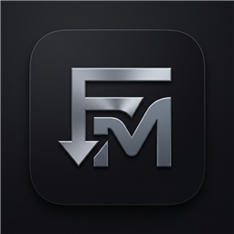
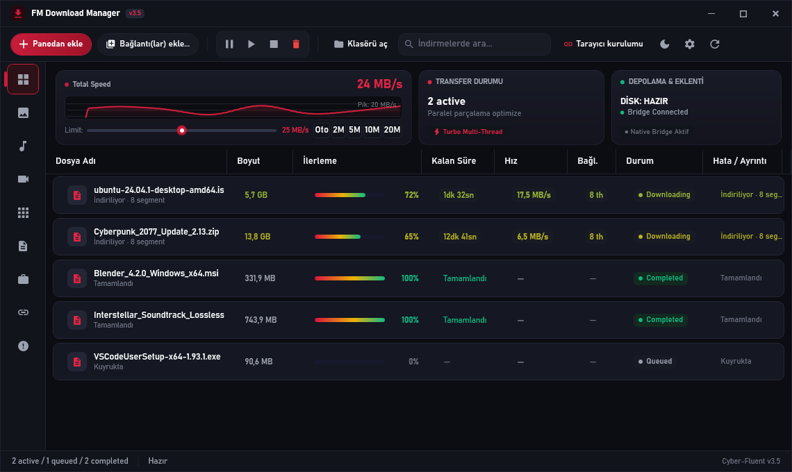
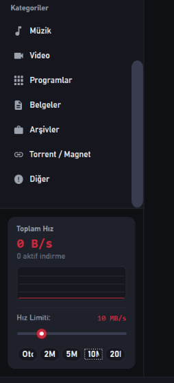
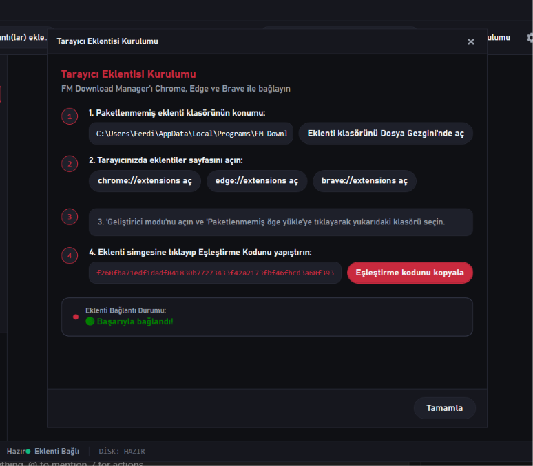
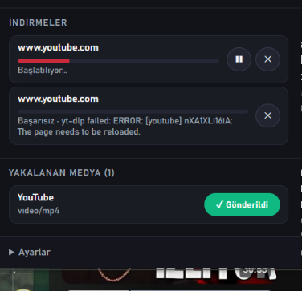
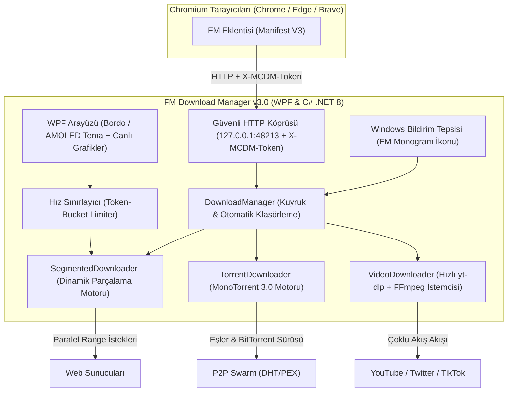

<p align="center">
  
</p>

<h1 align="center">FM Download Manager v3.4.3</h1>

<p align="center">
  <b>Ultra-hızlı, çok parçalı indirme yöneticisi, entegre BitTorrent motoru, akıllı tarayıcı entegrasyonu ve 4K medya yakalayıcısı (Windows 10 & 11).</b><br>
  <i>Modern Windows için sıfırdan inşa edilmiş, IDM ve FDM standartlarını aşan açık kaynaklı indirme istasyonu.</i>
</p>

<p align="center">
  <a href="https://github.com/Ferdi-krbk/fm-download-manager/releases"></a>
  <a href="https://dotnet.microsoft.com/download/dotnet/8.0"></a>
  <a href="https://github.com/Ferdi-krbk/fm-download-manager"></a>
  <a href="https://github.com/Ferdi-krbk/fm-download-manager"></a>
  <a href="LICENSE"></a>
</p>

<p align="center">
  <a href="#-ekran-görüntüleri-showcase">Arayüz &amp; Ekran Görüntüleri</a> •
  <a href="#-öne-çıkan-özellikler-highlights">Özellikler</a> •
  <a href="#-mimari-architecture">Mimari</a> •
  <a href="#-tarayıcı-kurulumu-browser-integration">Tarayıcı Entegrasyonu</a> •
  <a href="#-klavye-kısayolları-shortcuts">Kısayollar</a> •
  <a href="#-kurulum--installation">Kurulum</a>
</p>

---

## 📸 Ekran Görüntüleri (Showcase)

<p align="center">
  
  <br>
  <i>FM Download Manager v3.3.0 — Evrensel Medya Yakalama, 1 Gbps Turbo Motor, Otomatik Güncelleme Bildirimi ve Çok Parçalı İndirme Kuyruğu</i>
</p>

<br>

<table align="center" width="100%">
  <tr>
    <td width="33%" align="center">
      
      <br>
      <b>🎛️ Donanım Hızlandırmalı Hız Grafiği &amp; Slider</b>
      <p><i>EMA yumuşatma, pik hız göstergesi ve tek tıkla bant genişliği sınırlandırma</i></p>
    </td>
    <td width="33%" align="center">
      
      <br>
      <b>🌐 Sıfır Tık Eşleştirme (Zero-Click Pairing)</b>
      <p><i>Token.json tohumlama ile kod kopyalamadan otomatik bağlantı doğrulama</i></p>
    </td>
    <td width="33%" align="center">
      
      <br>
      <b>🎬 Akıllı Medya Yakalayıcısı</b>
      <p><i>YouTube, Twitter, TikTok, HDFilmcehennemi, NotebookLM ve 1000+ siteden tek tıkla 4K/MP3 indirme</i></p>
    </td>
  </tr>
</table>

---

## 🚀 Öne Çıkan Özellikler (Highlights)

```
┌────────────────────────────────────────────────────────────────────────┐
│  FM DOWNLOAD MANAGER v3.3.0 - UNIVERSAL MEDIA & TURBO EDITION          │
├────────────────────────────────────────────────────────────────────────┤
│  ⚡ 1 Gbps Turbo Motor (32 Segment) │  🧲 Dahili BitTorrent & Magnet   │
│  📊 Canlı Vektör Hız Grafiği (EMA)  │  🎛️ Anlık Hız Limiti Kadranı     │
│  🎬 YouTube 4K / MP3 & Hız Kalkanı  │  📂 Kategoriye Göre Otomatik Dizin│
│  🌐 Tek Tıkla Eklenti Kurulumu      │  ⏱️ Gece Kuyruk Planlayıcı       │
│  🎨 Bordo & AMOLED Çift Tema        │  🔒 256-Bit Yerel Token Güvenliği│
└────────────────────────────────────────────────────────────────────────┘
```

---

## 💎 Temel Yetenekler (Core Features)

### 1. ⚡ Dinamik Yeniden Segmentasyonlu Çok Parçalı Motor (Dynamic Resegmentation)
* Dosyaları 16 paralel bağlantıya kadar parçalayarak ISS sınırlarını ve sunucu bant genişliğini sonuna kadar kullanır.
* **Akıllı Parça Paylaşımı:** İndirme bitmeye yakınken yavaş kalan bir parça olduğunda, boşalan iş parçacığı o parçayı otomatik olarak ortadan ikiye bölerek kalan yarısını paralel çeker.

### 2. 🧲 Entegre BitTorrent & Magnet Desteği
* Harici bir torrent istemcisine (uTorrent, qBittorrent vb.) gerek kalmadan `magnet:?xt=urn:btih:...` ve `.torrent` bağlantılarını doğrudan çeker.
* MonoTorrent 3.0.2 motoruyla DHT, eş değişimi (PEX) ve şifreli aktarım sağlar.

### 3. 🎬 Süper Hızlı Medya & YouTube İndiricisi (MP4 Garantisi)
* `yt-dlp` ve `FFmpeg` motoruyla YouTube, Twitter/X, TikTok, Instagram ve 1000+ siteden tek tıkla video indirir.
* **Garantili MP4 Formatı:** Tüm videolar en yüksek kalitede otomatik olarak temiz MP4/M4A formatında birleştirilir ve remux edilir (asla uyumsuz WebM dosyaları oluşturmaz).
* **Format ve Kalite Seçici:** Bağlantı eklendiğinde açılan modern arayüzle *En Yüksek Kalite (4K/1080p)*, *720p HD* veya doğrudan *Yalnızca Ses Çıkar (MP3 / 320 kbps)* seçimi sunar.
* **Ultra-Hızlı Başlatma:** `--concurrent-fragments 4` ve optimize edilmiş istemci argümanlarıyla indirmeler saniyeler içinde anında başlar.

### 4. 💬 Evrensel Altyazı Yakalama & Otomatik VTT ➔ SRT Dönüştürücü
* **Bağımsız Altyazı İndirme:** Videoyu indirmeden yalnızca altyazı dosyasını (`.srt`) tek tıkla çekebilme imkanı.
* **Otomatik WebVTT ➔ SubRip (.srt) Dönüşümü:** Web oynatıcılarının sunduğu ham `.vtt` altyazıları otomatik olarak VLC, TV ve tüm medya oynatıcılarla %100 uyumlu standart `.srt` dosyalarına dönüştürülür.
* **Çoklu Dil Desteği:** Türkçe, İngilizce veya videoda tanımlı tüm yabancı dil parçalarını ve ağ üzerinden akan gizli altyazı akışlarını anında tespit eder.

### 5. 🚀 IDM Tarzı Modern Yüzen İndirme Butonu (Floating Bar)
* **Shadow DOM İzolasyonu:** Sayfa stillerinden ve sitelerin CSP/Trusted-Types güvenlik politikalarından etkilenmeyen bağımsız modern cam tasarım (Glassmorphic Pill).
* **Akıllı Hover Algılama:** YouTube, Twitter veya film/dizi sitelerinde videonun üzerine gelindiğinde sağ üst köşede otomatik olarak belirir.
* **Hızlı Açılır Menü:** Tek tıkla *Video İndir*, *MP3 İndir* veya *Altyazı Dili Seç* seçenekleri sunar.

### 6. 📊 Donanım Hızlandırmalı Canlı Vektör Hız Grafiği
* Sol kenar çubuğunda ve indirme ayrıntılarında WPF vektör çizimiyle gerçek zamanlı hız dalgalanmalarını gösterir.
* **EMA Filtresi & Bezier Eğrileri:** Ağ dalgalanmalarını Exponential Moving Average ile pürüzsüzleştirir, pik hız göstergesiyle birlikte akıcı bir grafik çizer.

### 7. 🎛️ Modern Hız Limiti Kadranı (Speed Limiter Slider)
* İndirme devam ederken sol paneldeki özel tasarımlı kaydırıcı veya hazır çipler (`[Oto] [2M] [5M] [10M] [20M]`) üzerinden tek tıkla internet kullanımını sınırlandırabilirsiniz.

### 8. 🌐 Sıfır Tık Tarayıcı Eklentisi Eşleştirmesi
* **Google Chrome, Microsoft Edge ve Brave** için eklenti klasör yolunu otomatik panoya kopyalar ve geliştirici sayfasını açar.
* Eklenti klasörüne otomatik olarak güvenlik anahtarı tohumlar (`token.json`). Kullanıcı kod kopyalayıp yapıştırmakla uğraşmadan eklenti tek tıkla yeşile döner ve eşleşir.

### 9. 📂 Otomatik Kategori Klasörlemesi
* Tamamlanan indirmeleri uzantılarına göre klasörlere ayırır:
  * `İndirilenler\Videos` (mp4, mkv, webm, avi...)
  * `İndirilenler\Music` (mp3, flac, wav, aac...)
  * `İndirilenler\Torrents` (torrent ve magnet indirmeleri)
  * `İndirilenler\Programs` (exe, msi, iso, apk...)
  * `İndirilenler\Documents` (pdf, docx, xlsx...)
  * `İndirilenler\Compressed` (zip, rar, 7z...)

### 10. ⏱️ Zamanlayıcı & Gece Planlayıcısı (Scheduler)
* Gece saatlerinde (örn. 02:00 – 07:00) indirmeleri otomatik başlatıp süre dolduğunda duraklatarak internet kotanızı ve bant genişliğinizi korur.

### 11. 🎨 Modern Çift Tema (Dark Burgundy & AMOLED Pure Black)
* Varsayılan koyu bordo ve titanyum grafit tasarımı (`#C92A3E` + `#121318`).
* Araç çubuğundaki ay simgesiyle tek tıkla **Derin Siyah AMOLED** (`#000000`) moduna geçiş imkanı.
* Keskin Windows DIN tipografisi (**Bahnschrift**) ve akıcı oval hatlar.

---

## 🏗️ Mimari (Architecture)



---

## ⌨️ Klavye Kısayolları (Shortcuts)

| Kısayol | İşlem |
|:---|:---|
| `Ctrl + V` | Panodaki indirme veya video bağlantısını anında ekle |
| `Ctrl + N` | Toplu URL / Bağlantı ekleme penceresini aç |
| `Ctrl + T` | Bordo Koyu Mod ile Derin Siyah AMOLED tema arasında geçiş yap |
| `Space` (Boşluk) | Seçili indirmeyi duraklat veya devam ettir |
| `Delete` | Seçili indirmeyi listeden kaldır |
| `Shift + Delete` | Seçili indirmeyi hem listeden hem de diskten kalıcı olarak sil |
| `Enter` | İndirilen dosyayı varsayılan uygulamasıyla aç |
| `F5` | İndirme listesini yenile |

---

## 📦 Kurulum (Installation)

1. [GitHub Releases](https://github.com/Ferdi-krbk/fm-download-manager/releases) sayfasından en son **`FMDownloadManager-Setup-3.4.0.exe`** dosyasını indirin.
2. Kurulum sihirbazını çalıştırın (kullanıcı bazlı temiz kurulum, yönetici izni gerektirmez).
3. Program açıldığında araç çubuğundaki **Tarayıcı Eklentisi** butonuna tıklayın ve tarayıcınızı seçin. Eklenti saniyeler içinde otomatik olarak yüklenip eşleşecektir.

---

## 🛠️ Kaynaktan Derleme (Building from Source)

Gereksinimler:
* [.NET 8.0 SDK](https://dotnet.microsoft.com/download/dotnet/8.0)
* Windows 10/11 x64

```powershell
# 1. Depoyu klonlayın
git clone https://github.com/Ferdi-krbk/fm-download-manager.git
cd fm-download-manager

# 2. Testleri çalıştırın
dotnet run --project tests/McDm.Tests

# 3. Bağımsız (Self-Contained) Release sürümünü derleyin
dotnet publish src/McDm.App/McDm.App.csproj -c Release -r win-x64 --self-contained -p:PublishSingleFile=true -o publish/win-x64
```

---

## 📄 Lisans

Bu proje [MIT Lisansı](LICENSE) altında dağıtılmaktadır.
Mesut Çevik'in açık kaynaklı [MC Download Manager](https://github.com/mstcvk/mc-download-manager) projesinden esinlenilmiş ve Windows için sıfırdan geliştirilmiştir.
