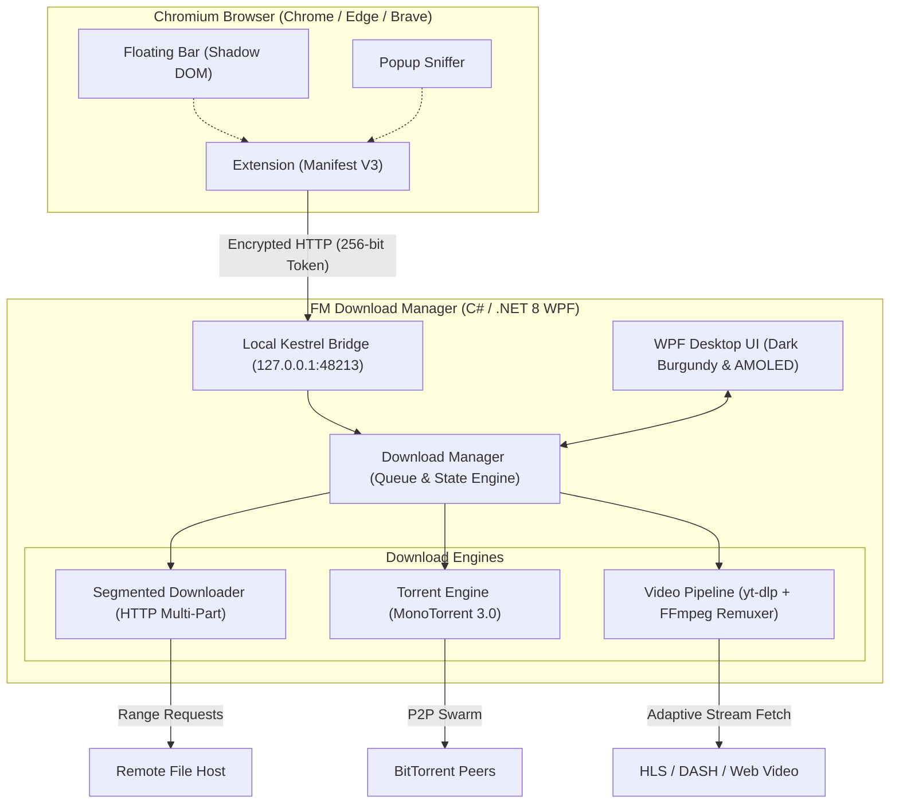

<p align="center">
  
</p>

<h1 align="center">FM Download Manager</h1>

<p align="center">
  <b>Modern, lightweight, and high-performance download manager for Windows 10 & 11.</b><br>
  <i>Engineered with dynamic multi-part acceleration, native BitTorrent engine, intelligent media sniffer, and IDM-style floating controls.</i>
</p>

<p align="center">
  <a href="https://github.com/Ferdi-krbk/fm-download-manager/releases"></a>
  <a href="https://dotnet.microsoft.com/download/dotnet/8.0"></a>
  <a href="https://github.com/Ferdi-krbk/fm-download-manager"></a>
  <a href="https://github.com/Ferdi-krbk/fm-download-manager"></a>
  <a href="LICENSE"></a>
  <a href="README.tr.md"></a>
</p>

<p align="center">
  <a href="#-overview">Overview</a> •
  <a href="#-key-features">Key Features</a> •
  <a href="#-supported-media--streaming-protocols">Supported Media</a> •
  <a href="#-architecture">Architecture</a> •
  <a href="#-installation">Installation</a> •
  <a href="#-keyboard-shortcuts">Shortcuts</a> •
  <a href="#-building-from-source">Build</a>
</p>

---

<p align="center">
  
</p>

---

## 📌 Overview

**FM Download Manager** is an open-source, modern desktop download manager built natively in C# / WPF on **.NET 8**. Designed as a clean, bloatware-free alternative to legacy software, it focuses on raw download throughput, minimal memory footprint, and reliable browser integration.

* **100% Local & Private:** No telemetry, no background analytics, no ads, and no external cloud dependencies.
* **Modern Windows Native:** Built with hardware-accelerated WPF, crisp Bahnschrift typography, and dual dark themes (Deep Burgundy & Pure AMOLED Black).
* **Universal Browser Bridge:** Secure local HTTP bridge (`127.0.0.1:48213`) connecting Chromium browsers (Chrome, Edge, Brave) via 256-bit token authentication.

---

## ⚡ Key Features

### 1. Dynamic Resegmentation Engine
Traditional multi-part downloaders divide files into fixed chunks. If a single connection slows down or stalls, the entire download halts at the end. FM Download Manager dynamically monitors active chunks: when a worker finishes its segment early, it automatically splits the slowest remaining chunk in half and downloads the remainder in parallel, ensuring full line-rate bandwidth utilization.

### 2. Native BitTorrent & Magnet Integration
Built on the robust **MonoTorrent 3.0** library:
* Direct handling of `magnet:?xt=urn:btih:...` links and `.torrent` files without requiring secondary torrent clients (such as qBittorrent or uTorrent).
* Distributed Hash Table (DHT), Peer Exchange (PEX), Local Peer Discovery (LSD), and encrypted peer connections.

### 3. High-Fidelity Media Pipeline (Guaranteed MP4 Output)
Powered by customized `yt-dlp` and `FFmpeg` toolchains:
* Single-click capture from YouTube, Twitter/X, TikTok, Instagram, Reddit, Vimeo, Facebook, and 1000+ web platforms.
* **Clean MP4 Remuxing:** High-resolution video and audio streams are automatically paired and remuxed into clean, universally playable `.mp4` containers (eliminating incompatible WebM playback issues).
* **Quality Selector:** Intuitive dialog for picking *Ultra Quality (4K60 / 1080p60)*, *720p HD*, or extracting *Audio Only (MP3 / 320 kbps)*.

### 4. Dual-Audio & Multi-Track Stream Pairing
Web video players often serve adaptive HLS (`.m3u8`) or DASH (`.mpd`) streams containing multiple independent audio tracks (e.g. Dubbed and Original languages):
* Resolves the common issue where downloaders only capture the isolated audio stream (~20 MB) instead of the full video.
* Accurately pairs the requested video resolution with the desired audio stream, outputting a complete, high-bitrate media file.

### 5. Universal Subtitle Extraction & VTT ➔ SRT Converter
Full control over embedded and remote subtitles:
* **3 Download Modes:**
  1. *Video + Subtitles:* Downloads the video while simultaneously packaging the selected subtitle.
  2. *Subtitles Only (`.srt`):* Grabs the subtitle file in seconds without downloading video bytes.
  3. *Clean Video:* Downloads the raw video stream with no subtitle overhead.
* **Automatic VTT ➔ SRT Normalization:** Online players typically stream subtitles in raw WebVTT format. FM Download Manager normalizes timestamps, strips styling tags, and outputs standard SubRip (`.srt`) files compatible with Smart TVs, media servers, and VLC.

### 6. IDM-Style Floating Media Bar
* **Shadow DOM Isolation:** Injected into pages via an encapsulated Shadow DOM barrier, completely immune to host page CSS conflicts.
* **Trusted Types & CSP Compliant:** Engineered with 100% pure DOM node construction, satisfying strict Content Security Policies on modern platforms like YouTube.
* **Hover Detection:** Appears smoothly at the top-right corner when hovering over video elements or embedded iframe players.

### 7. Bandwidth Management & Vector Speed Graph
* **Vector Waveform Display:** Real-time throughput graph utilizing Exponential Moving Average (EMA) filtering to smooth out erratic network spikes.
* **Speed Limiter Slider:** Dynamic control slider with instant presets (`[Auto] [2M] [5M] [10M] [20M]`) to limit download speed on the fly without interrupting transfers.
* **Night Queue Scheduler:** Set automated start/stop windows (e.g., 02:00 – 07:00) to schedule large downloads during off-peak hours.

---

## 🎬 Supported Media & Streaming Protocols

| Category | Supported Sources & Formats | Capabilities |
|---|---|---|
| **Major Platforms** | YouTube, Twitter/X, TikTok, Instagram, Reddit, Vimeo, Facebook | Up to 4K60 HDR, MP3 320k, Subtitle extraction, Instant hover bar |
| **3rd-Party Web Players** | HLS (`.m3u8`), DASH (`.mpd`), MP4/WebM direct embeds | Dual-Audio stream pairing (Dubbed + Original), resolution selector |
| **Subtitle Formats** | WebVTT (`.vtt`), SubRip (`.srt`), Player Caption Streams | Auto VTT ➔ SRT conversion, multi-language selector, standalone download |
| **BitTorrent** | Magnet URIs, `.torrent` metadata files | Multi-file torrent support, DHT/PEX, encrypted peer communication |
| **Direct Web Downloads** | HTTP/1.1, HTTP/2, Chunked, Range-based transfers | Dynamic multi-threading (up to 16 connections), auto-retry, atomic state |

---

## 🏗️ Architecture



---

## 📦 Installation

### Option 1: Windows Installer (Recommended)
1. Download `FMDownloadManager-Setup-3.4.3.exe` from the [Latest Releases](https://github.com/Ferdi-krbk/fm-download-manager/releases).
2. Run the installer. It installs the application to `%LOCALAPPDATA%\Programs\FM Download Manager` (no administrator privileges required).
3. The installer automatically unpacks the companion browser extension and opens the browser setup page.

### Option 2: Browser Extension Setup
1. In Google Chrome, Microsoft Edge, or Brave, open `chrome://extensions`.
2. Toggle on **Developer Mode** (top right corner).
3. Click **Load unpacked** and select the extension directory (found in the program folder under `extension` or downloaded from releases).
4. The extension automatically detects the local bridge token and pairs with a green indicator.

---

## ⌨️ Keyboard Shortcuts

| Shortcut | Description |
|---|---|
| `Ctrl + N` | Add new download URL (File, Media, or Magnet) |
| `Ctrl + V` | Paste URL from clipboard |
| `Ctrl + F` | Focus instant search box |
| `Space` | Pause or Resume selected download |
| `Delete` | Remove selected task from list |
| `Shift + Delete` | Remove task and delete downloaded file from disk |
| `Ctrl + Shift + T` | Toggle between Dark Burgundy and Deep AMOLED Black themes |
| `Ctrl + ,` | Open Settings dialog |

---

## 🛠️ Building from Source

### Prerequisites
* Windows 10 or 11 (x64)
* [.NET 8.0 SDK](https://dotnet.microsoft.com/download/dotnet/8.0)
* Git for Windows

```bash
# Clone the repository
git clone https://github.com/Ferdi-krbk/fm-download-manager.git
cd fm-download-manager

# Restore dependencies & build
dotnet restore
dotnet build -c Release

# Run automated test suites (Full matrix)
node tests/test_full_download_matrix.js
dotnet test tests/McDm.Tests/McDm.Tests.csproj

# Run application
dotnet run --project src/McDm.App/McDm.App.csproj
```

---

## 📄 License & Acknowledgments

* **License:** Licensed under the [MIT License](LICENSE).
* **Upstream Heritage:** Inspired by the macOS open-source project [MC Download Manager](https://github.com/mstcvk/mc-download-manager) by [Mesut Çevik](https://github.com/mstcvk). Fully rewritten and architected for Windows 10 & 11.
* **Core Libraries:** Powered by [.NET 8](https://github.com/dotnet), [MonoTorrent](https://github.com/alanmcgovern/monotorrent), [yt-dlp](https://github.com/yt-dlp/yt-dlp), and [FFmpeg](https://ffmpeg.org/).
