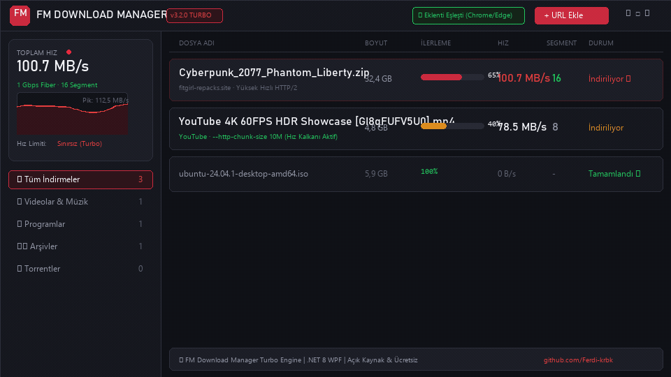
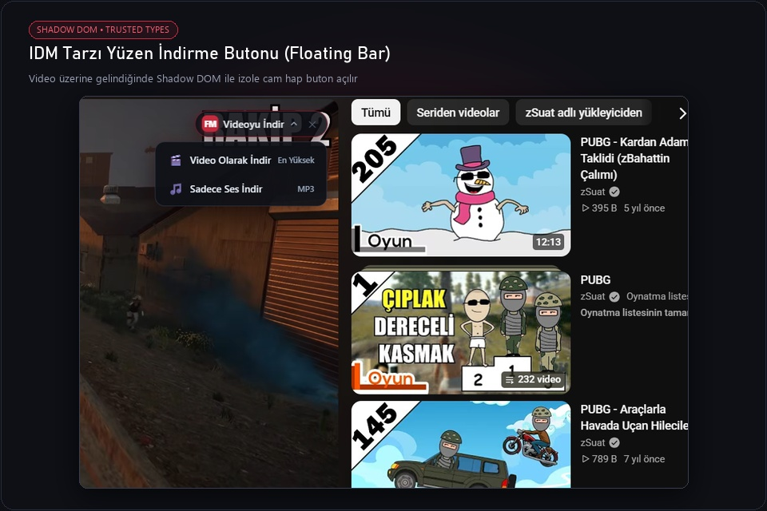
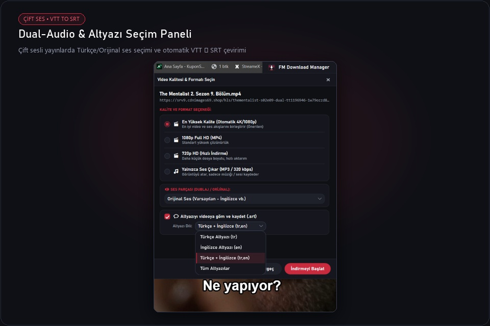
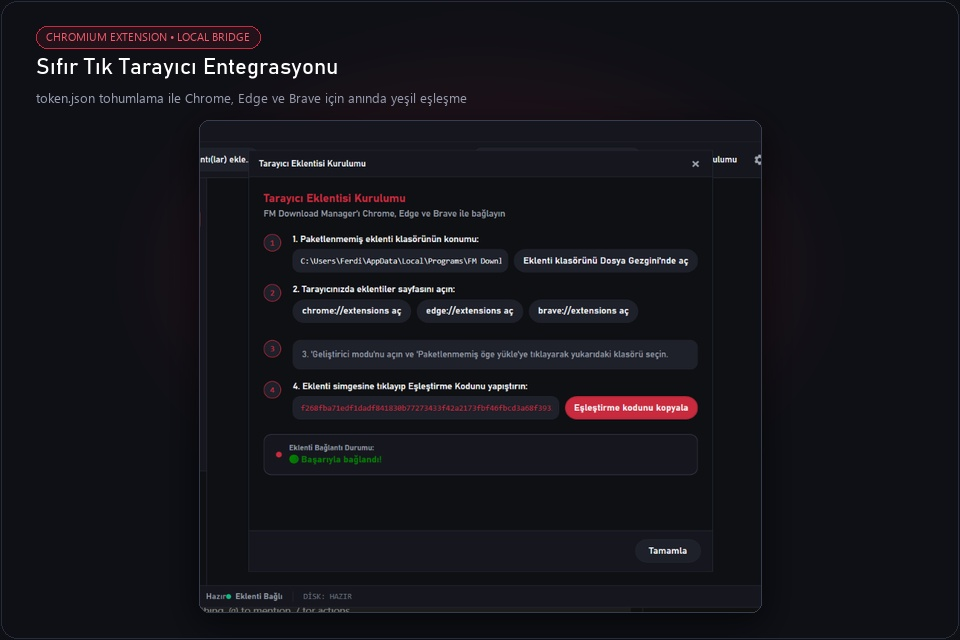
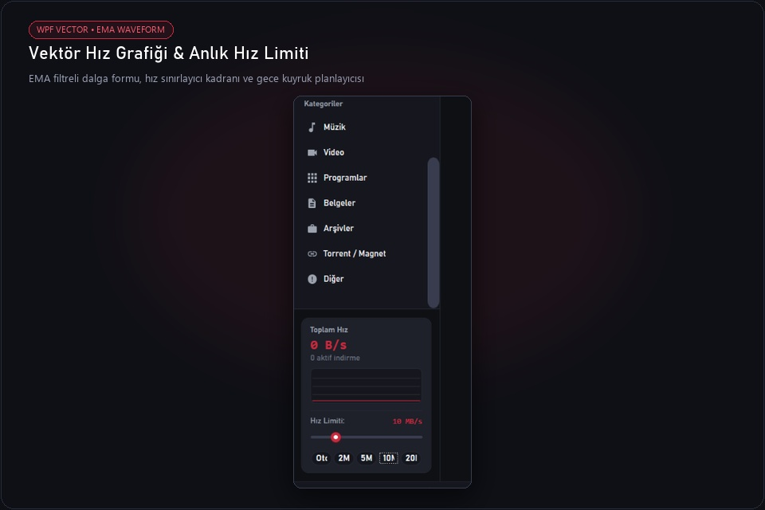

<p align="center">
  <a href="https://github.com/Ferdi-krbk/fm-download-manager">
    
  </a>
</p>

<h1 align="center">FM Download Manager</h1>

<p align="center">
  <b>Ultra-Hızlı Çok Parçalı İndirme Motoru • Entegre BitTorrent İstemcisi • Evrensel Medya &amp; Dual-Audio Hattı • IDM Tarzı Yüzen Kontroller</b><br>
  <i>Windows 10 ve 11 için donanım hızlandırmalı .NET 8 WPF ile sıfırdan inşa edilmiş modern indirme istasyonu.</i>
</p>

<p align="center">
  <a href="https://github.com/Ferdi-krbk/fm-download-manager/releases/latest"></a>
  <a href="https://dotnet.microsoft.com/download/dotnet/8.0"></a>
  <a href="https://github.com/Ferdi-krbk/fm-download-manager"></a>
  <a href="https://github.com/Ferdi-krbk/fm-download-manager"></a>
  <a href="LICENSE"></a>
  <a href="README.md"></a>
</p>

<p align="center">
  <a href="#-canlı-önizleme-showcase">Canlı Önizleme</a> •
  <a href="#-karşılaştırma-ve-özellik-matrisi">Özellik Matrisi</a> •
  <a href="#-derinlemesine-yetenekler">Yetenekler</a> •
  <a href="#-mimari">Mimari</a> •
  <a href="#-hızlı-kurulum">Kurulum</a> •
  <a href="#-klavye-kısayolları">Kısayollar</a>
</p>

---

## 🎬 Canlı Önizleme (Showcase)

<p align="center">
  
</p>

<p align="center">
  <b>⚡ Gerçek Zamanlı Çok Parçalı İndirme ve Canlı Dalga Formlu Vektör Hız Grafiği (EMA Telemetrisi)</b>
</p>

---

## ✨ Görsel Özellik Vitrini (Feature Cards)

<table width="100%">
  <tr>
    <td width="50%" valign="top">
      <h3 align="center">🚀 IDM Tarzı Yüzen İndirme Çubuğu</h3>
      <p align="center">
        
      </p>
      <ul>
        <li><b>İzole Shadow DOM:</b> Web sitelerinin CSS ve stillerinden asla etkilenmez.</li>
        <li><b>Katı CSP &amp; Trusted-Types Uyumlu:</b> Saf DOM düğümleriyle YouTube'da sıfır hata.</li>
        <li><b>Pürüzsüz Hover Algılama:</b> Fareyi video üzerine getirdiğiniz anda pürüzsüzce açılır.</li>
      </ul>
    </td>
    <td width="50%" valign="top">
      <h3 align="center">🎧 Dual-Audio &amp; Altyazı Hattı</h3>
      <p align="center">
        
      </p>
      <ul>
        <li><b>Çift Ses (Dual-Audio) Eşleme:</b> 3. parti web oynatıcılarında videoyu tercih edilen ses parçasıyla (TR Dublaj / Orijinal) birleştirir.</li>
        <li><b>Otomatik VTT ➔ SRT Çevirici:</b> Ham WebVTT altyazılarını VLC ve televizyonla %100 uyumlu SRT formatına dönüştürür.</li>
        <li><b>3 İndirme Modu:</b> Video + Altyazı, Bağımsız <code>.srt</code> veya Altyazısız Ham Video.</li>
      </ul>
    </td>
  </tr>
  <tr>
    <td width="50%" valign="top">
      <h3 align="center">🌐 Sıfır Tık Eklenti Eşleştirmesi</h3>
      <p align="center">
        
      </p>
      <ul>
        <li><b>Otomatik Token Tohumlama:</b> Kurulum anında <code>token.json</code> eklenti klasörüne yazılır.</li>
        <li><b>Tek Tıkla Eşleşme:</b> Kod kopyalamaya gerek kalmadan eklenti simgesi yeşile döner.</li>
        <li><b>Chromium Desteği:</b> Google Chrome, Microsoft Edge ve Brave ile eksiksiz çalışır.</li>
      </ul>
    </td>
    <td width="50%" valign="top">
      <h3 align="center">📊 Vektör Hız Grafiği &amp; Hız Limiti</h3>
      <p align="center">
        
      </p>
      <ul>
        <li><b>EMA Filtreli Telemetri:</b> Üstel Hareketli Ortalama ile ağ dalgalanmalarını pürüzsüzleştirir.</li>
        <li><b>İnteraktif Hız Kadranı:</b> Tek tıkla hazır limit çipleri (<code>Oto</code>, <code>2M</code>, <code>5M</code>, <code>10M</code>, <code>20M</code>).</li>
        <li><b>Gece Kuyruk Planlayıcısı:</b> Kotanızı korumak için gece saatlerinde otomatik indirme.</li>
      </ul>
    </td>
  </tr>
</table>

---

## 💎 Karşılaştırma ve Özellik Matrisi

| Özellik | FM Download Manager v3.4.3 | Standart Tarayıcılar | Klasik İndirme Yöneticileri |
|---|:---:|:---:|:---:|
| **Dinamik Yeniden Segmentasyon** | ✅ **Canlı Parça Bölme** | ❌ Tek Bağlantı | ⚠️ Sabit parçalar |
| **Entegre BitTorrent & Magnet** | ✅ **Dahili (MonoTorrent 3.0)** | ❌ Desteklemez | ❌ Harici istemci gerekir |
| **YouTube 4K & MP3 Çıkarıcı** | ✅ **Garantili MP4 Remux** | ❌ İndiremez | ⚠️ Sürekli bozulur / WebM |
| **Çift Ses (Dual-Audio) Eşleme** | ✅ **Tam Video + Ses Mux** | ❌ Sadece ses iner | ❌ Bozuk / 19 MB ses dosyası |
| **Evrensel VTT ➔ SRT Altyazı** | ✅ **3 Mod + VLC Uyumlu** | ❌ Desteklemez | ❌ Desteklemez |
| **CSP / Trusted Types Floating Bar** | ✅ **Shadow DOM Güvenli** | ❌ Yok | ⚠️ Sitelerde hata verir |
| **Sıfır Tık Eklenti Eşleştirmesi** | ✅ **Otomatik Token Tohumlama** | — | ❌ Manuel ayar / Reklam |
| **Telemetri ve Reklam** | 🛡️ **%100 Ücretsiz & Sıfır Takip** | ⚠️ Yoğun Telemetri | ❌ Reklam / Ücretli Lisans |

---

## ⚡ Derinlemesine Yetenekler

```
┌────────────────────────────────────────────────────────────────────────┐
│  FM DOWNLOAD MANAGER v3.4.3 — EVRENSEL MEDYA & TURBO MOTOR             │
├────────────────────────────────────────────────────────────────────────┤
│  ⚡ 1 Gbps Turbo Çok Parçalı Motor │  🧲 Dahili BitTorrent & Magnet   │
│  📊 Canlı Vektör EMA Hız Grafiği   │  🎛️ Anlık Hız Limiti Kadranı     │
│  🎬 YouTube 4K60 / MP3 Remuxer     │  💬 Otomatik VTT ➔ SRT Altyazı   │
│  🎧 Dual-Audio Çift Ses Eşleme     │  🎥 3. Parti Web Oynatıcı Uyumu  │
│  🌐 Sıfır Tık Eklenti Entegrasyonu │  ⏱️ Gece Kuyruk Planlayıcı       │
│  🎨 Bordo & AMOLED Çift Tema       │  🔒 256-Bit Yerel Token Güvenliği│
└────────────────────────────────────────────────────────────────────────┘
```

### 1. ⚡ Dinamik Yeniden Segmentasyon Motoru
Büyük dosyalarda (ISO kalıpları, oyunlar, arşivler), sabit parçalı indiriciler son parçanın takılması yüzünden bekletir. FM Download Manager aktif iş parçacıklarının bayt hızını saniye saniye izler. Boşa çıkan bir iş parçacığı olduğunda en yavaş ilerleyen parçayı ortadan ikiye bölerek kalan yarısını paralel indirmeye başlar.

### 2. 🧲 Entegre BitTorrent & Magnet İstemcisi
Ekstra ağır torrent programları kurmanıza gerek kalmaz:
* Magnet bağlantıları (`magnet:?xt=urn:...`) ve `.torrent` dosyaları doğrudan ana indirme listesine eklenir.
* **MonoTorrent 3.0** motoruyla DHT, Eş Değişimi (PEX), Yerel Eş Keşfi (LSD) ve şifreli veri aktarımını eksiksiz destekler.

### 3. 🎬 Medya İşleme Hattı & Temiz MP4 Çıktısı
Gömülü `yt-dlp` ve `FFmpeg` işleme hattı ile donatılmıştır:
* YouTube, Twitter/X, TikTok, Instagram, Reddit, Vimeo, Facebook ve 1000'den fazla siteden tek tıkla medya yakalama.
* **Garantili MP4 Formatı:** Ayrı akan görüntü ve ses akışlarını anında temiz `.mp4` formatında birleştirir (oynatma sorunu çıkaran WebM dosyalarına son verir).
* **Format Seçici:** *En Yüksek Kalite (4K60 / 1080p60)*, *720p HD* veya doğrudan *Yalnızca Ses Çıkar (MP3 / 320 kbps)* seçenekleri.

### 4. 🎧 Dual-Audio (Çift Ses) ve Çoklu Parça Eşleme
Modern web video oynatıcılarında kullanılan HLS (`.m3u8`) veya DASH (`.mpd`) yayınları birden fazla bağımsız ses parçası barındırır (örn. Türkçe Dublaj ve Orijinal Dil):
* **Sorun:** Standart indiriciler sadece ilk izole ses akışını yakalayıp ~20 MB'lık görüntüsüz ses dosyası indirir.
* **Çözüm:** FM Download Manager seçilen video çözünürlüğü ile istenen ses parçasını otomatik eşleştirerek ~700 MB - 2 GB aralığında eksiksiz bir MP4 videoya dönüştürür.

### 5. 💬 Evrensel Altyazı Yakalama & VTT ➔ SRT Dönüştürücü
* **3 Esnek Mod:**
  1. *Video + Altyazı:* Videoyu seçtiğiniz altyazı diliyle birlikte indirme.
  2. *Yalnızca Altyazı (`.srt`):* Videoyu indirmeden doğrudan `.srt` altyazı dosyasını saniyeler içinde kaydetme.
  3. *Altyazısız Temiz Video:* Ham video akışını indirme.
* **Otomatik Normalizasyon:** Web oynatıcılarının sunduğu ham WebVTT altyazılarını zaman damgalarından ve stil etiketlerinden temizleyerek VLC, televizyonlar ve telefonlarla tam uyumlu standart SubRip (`.srt`) formatına çevirir.

### 6. 🚀 Modern Shadow DOM Yüzen İndirme Butonu
* Sayfa stillerinden etkilenmeyen izole Shadow DOM yapısı.
* Saf DOM düğümü inşası sayesinde modern web sitelerinin ve YouTube'un katı Trusted-Types / CSP güvenlik politikalarına %100 uyumluluk.
* Video oynatıcılarının ve gömülü iframe pencerelerinin üzerine gelindiğinde pürüzsüz animasyonla belirir.

---

## 🏗️ Mimari


---

## 📦 Hızlı Kurulum

### Yöntem 1: Windows Kurulum Paketi (Önerilen)
1. Güncel kurulum dosyasını indirin: [FMDownloadManager-Setup-3.4.3.exe](https://github.com/Ferdi-krbk/fm-download-manager/releases/download/v3.4.3/FMDownloadManager-Setup-3.4.3.exe).
2. Kurulumu çalıştırın (yönetici izni gerektirmeden `%LOCALAPPDATA%\Programs\FM Download Manager` dizinine yüklenir).
3. Kurulum tamamlandığında tarayıcı eklentisi klasörü ve kurulum rehberi otomatik olarak açılır.

### Yöntem 2: Tarayıcı Eklentisi Kurulumu
1. Chrome, Edge veya Brave tarayıcınızda `chrome://extensions` adresine gidin.
2. Sağ üstteki **Geliştirici Modu**nu açın.
3. **Paketlenmemiş öge yükle** butonuna basarak program dizinindeki `extension` klasörünü seçin.
4. Eklenti yerel anahtarı (`token.json`) otomatik okur ve yeşil renkle eşleşir!

---

## ⌨️ Klavye Kısayolları

| Kısayol | İşlev |
|---|---|
| `Ctrl + N` | Yeni indirme bağlantısı ekle (Dosya, Medya veya Magnet) |
| `Ctrl + V` | Panodaki bağlantıyı otomatik yapıştır |
| `Ctrl + F` | Hızlı arama ve filtreleme kutusuna odaklan |
| `Space` | Seçili indirmeyi duraklat veya devam ettir |
| `Delete` | Görevi listeden kaldır |
| `Shift + Delete` | Görevi listeden kaldır ve indirilen dosyayı diskten kalıcı olarak sil |
| `Ctrl + Shift + T` | Koyu Bordo ve Derin AMOLED Siyah temaları arasında geçiş yap |
| `Ctrl + ,` | Ayarlar penceresini aç |

---

## 🛠️ Kaynak Koddan Derleme

```bash
# 1. Depoyu klonlayın
git clone https://github.com/Ferdi-krbk/fm-download-manager.git
cd fm-download-manager

# 2. Bağımlılıkları geri yükleyin ve derleyin
dotnet restore
dotnet build -c Release

# 3. 68 vaka otomasyon testlerini çalıştırın
node tests/test_full_download_matrix.js
dotnet test tests/McDm.Tests/McDm.Tests.csproj

# 4. Uygulamayı başlatın
dotnet run --project src/McDm.App/McDm.App.csproj
```

---

## 📄 Lisans & Teşekkür

* **Lisans:** Bu proje [MIT Lisansı](LICENSE) kapsamında açık kaynak olarak sunulmaktadır.
* **Köken:** [Mesut Çevik](https://github.com/mstcvk) tarafından macOS için geliştirilen açık kaynaklı [MC Download Manager](https://github.com/mstcvk/mc-download-manager) projesinden esinlenilmiş; modern Windows 10 & 11 için baştan modellenmiştir.
* **Kullanılan Çekirdek Kütüphaneler:** [.NET 8](https://github.com/dotnet), [MonoTorrent](https://github.com/alanmcgovern/monotorrent), [yt-dlp](https://github.com/yt-dlp/yt-dlp) ve [FFmpeg](https://ffmpeg.org/).
