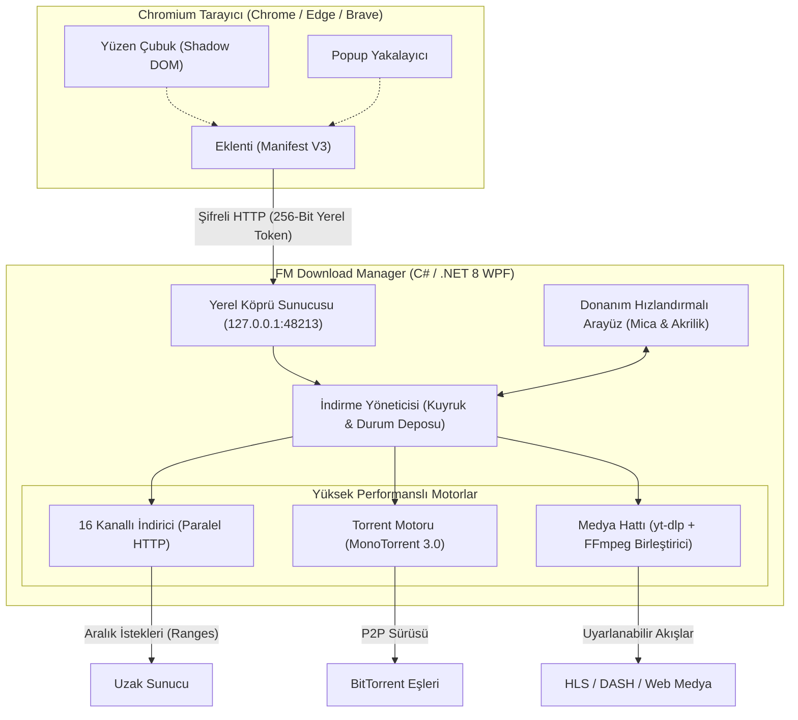

<p align="center">
  <a href="https://github.com/Ferdi-krbk/fm-download-manager">
    
  </a>
</p>

<h1 align="center">FM Download Manager</h1>

<p align="center">
  <b>Windows 10 ve 11 İçin Yeni Nesil Ultra-Hızlı İndirme İstasyonu</b><br>
  <i>16 Kanallı Dinamik Paralel Hızlandırma • IDM Tarzı Yüzen Video Çubuğu • Evrensel 4K &amp; Çift Ses (Dual-Audio) Hattı • Entegre BitTorrent İstemcisi • Fluent Mica Glassmorphic Tasarım</i>
</p>

<p align="center">
  <a href="https://github.com/Ferdi-krbk/fm-download-manager/releases/latest"></a>
  <a href="https://dotnet.microsoft.com/download/dotnet/8.0"></a>
  <a href="https://github.com/Ferdi-krbk/fm-download-manager"></a>
  <a href="https://github.com/Ferdi-krbk/fm-download-manager"></a>
  <a href="LICENSE"></a>
  <a href="README.md"></a>
</p>

<p align="center">
  <a href="https://github.com/Ferdi-krbk/fm-download-manager/releases/download/v3.7.1/FMDownloadManager-Setup-3.7.1.exe">
    
  </a>
  <a href="https://ferdi-krbk.github.io/fm-download-manager/" target="_blank">
    
  </a>
</p>

<p align="center">
  <a href="#-neden-fm-download-manager">Neden FM?</a> •
  <a href="#-görsel-tur-ve-ekran-görüntüleri">Ekran Görüntüleri</a> •
  <a href="#-karşılaştırma-ve-özellik-matrisi">Özellik Matrisi</a> •
  <a href="#-derinlemesine-yetenekler">Yetenekler</a> •
  <a href="#-mimari">Mimari</a> •
  <a href="#-hızlı-kurulum">Kurulum</a> •
  <a href="#-klavye-kısayolları">Kısayollar</a>
</p>

---

## ⚡ Canlı Önizleme (Showcase)

<p align="center">
  
</p>

<p align="center">
  <b>⚡ 16 Kanallı Yeniden Parçalama ve Canlı Dalga Formlu Vektör Hız Grafiği (EMA Telemetrisi)</b><br>
  <a href="https://ferdi-krbk.github.io/fm-download-manager/" target="_blank"><b>👉 İnteraktif Web Tanıtımını Tarayıcıda Canlı Deneyimlemek İçin Tıklayın</b></a>
</p>

---

## 💡 Neden FM Download Manager?

Günümüzde kullanılan çoğu masaüstü indirme yöneticisi 2000'lerin başındaki mantıkla çalışır:
- **Eski ve Hantal Arayüzler:** 90'lardan kalma gri pencereler, bulanık yazı tipleri ve göz yoran parlak arayüzler.
- **Sürekli Crack/Lisans Derdi:** Deneme süresi uyarıları, sahte lisans pencereleri ve güvenliği tehlikeye atan zararlı crack dosyaları.
- **Bozuk Medya İndirmeleri:** Film yerine 19 MB'lık boş ses dosyası indiren, modern HLS/DASH akışlarında çöken veya altyazıları bozan eski araçlar.
- **Gizli Reklam ve Telemetri:** Arka planda sistemi yoran takip kodları ve gereksiz araç çubukları.

**FM Download Manager tüm bu sorunları kökten çözmek için modern teknolojilerle tasarlandı:**
1. **Windows 11 Yerel Fluent Mica & Koyu Akrilik Tasarım:** İpeksi pürüzsüzlükte WPF animasyonları, dinamik renk paletleri ve yüksek DPI kristal netliğinde arayüz.
2. **16 Kanallı Dinamik Çok Parçalı Motor:** Dosyaları 16 eşzamanlı HTTP bağlantısına böler; yavaşlayan parçaları canlı olarak otomatik yeniden bölerek internet bant genişliğinizi son damlasına kadar kullanır.
3. **Evrensel Medya ve Çift Ses (Dual-Audio) Zekası:** YouTube, Twitter/X, TikTok, film/dizi siteleri ve 1000'den fazla kaynaktaki videoları yakalar. Türkçe Dublaj / Orijinal ses seçeneklerini birleştirir, WebVTT altyazıları otomatik standart SubRip (`.srt`) formatına dönüştürür.
4. **Entegre BitTorrent İstemcisi:** Ekstra bir torrent programına ihtiyaç duymadan Magnet linkleri ve `.torrent` dosyalarını doğrudan indirir.
5. **%100 Açık Kaynak ve Ücretsiz:** Reklam yok, gizli üyelik yok, takip yok; MIT lisansı altında tamamen özgür.

---

## 📸 Görsel Tur ve Ekran Görüntüleri

<table width="100%">
  <tr>
    <td width="50%" valign="top">
      <h3 align="center">🖥️ Fluent Akrilik Masaüstü Paneli</h3>
      <p align="center">
        
      </p>
      <ul>
        <li><b>16 Kanallı Canlı Segment Çubukları:</b> IDM tarzı renkli bloklarla her parçanın doluşunu anlık izleyin.</li>
        <li><b>Vektör Dalga Formu Hız Grafiği:</b> Üstel Hareketli Ortalama (EMA) filtreli dalgalanmasız pürüzsüz telemetri.</li>
        <li><b>Sürükle &amp; Bırak Desteği:</b> Linkleri veya torrent dosyalarını doğrudan pencereye bırakın.</li>
      </ul>
    </td>
    <td width="50%" valign="top">
      <h3 align="center">🎬 Evrensel Video &amp; Altyazı Yakalayıcı</h3>
      <p align="center">
        
      </p>
      <ul>
        <li><b>Tek Tıkla 4K / 1080p / MP3:</b> Video kapağı ve süre bilgisiyle anında kalite seçimi.</li>
        <li><b>Çift Ses (Dual-Audio) Birleştirici:</b> Türkçe Dublaj veya Orijinal ses parçalarını FFmpeg ile tam MP4 olarak birleştirir.</li>
        <li><b>Altyazı Dönüştürücü:</b> WebVTT altyazılarını VLC ve Smart TV uyumlu standart SubRip (`.srt`) yapar.</li>
      </ul>
    </td>
  </tr>
  <tr>
    <td width="50%" valign="top">
      <h3 align="center">🎨 Dinamik Renk Paleti &amp; Senkronizasyon</h3>
      <p align="center">
        
      </p>
      <ul>
        <li><b>5 Özel Renk Teması:</b> Hyper Crimson, Zümrüt Yeşili, Kehribar Sarısı, Safir Mavisi ve Elektrik Moru.</li>
        <li><b>Anında Eklenti Senkronizasyonu:</b> Masaüstünde rengi veya dili değiştirdiğinizde tarayıcı eklentisi de anında güncellenir.</li>
        <li><b>AMOLED ve Koyu Bordo:</b> OLED ekranlar için derin siyah ve yüksek kontrast modları.</li>
      </ul>
    </td>
    <td width="50%" valign="top">
      <h3 align="center">⚡ 16 Kanallı Segment ve Parça Denetleyicisi</h3>
      <p align="center">
        
      </p>
      <ul>
        <li><b>Ayrıntılı Kanal Telemetrisi:</b> Her bir HTTP parçasının bayt aralığını, indirilen miktarını ve yüzdesini canlı izleyin.</li>
        <li><b>IDM Tarzı Görsel Segmentleme:</b> Büyük dosyaların 16 paralel TCP soketine nasıl bölündüğünü görsel olarak inceleyin.</li>
        <li><b>Dinamik Yeniden Parçalama:</b> Yavaş kalan soket parçalarını tespit edip otomatik olarak yeniden bölerek maksimum hıza ulaşır.</li>
      </ul>
    </td>
  </tr>
</table>

---

## 💎 Karşılaştırma ve Özellik Matrisi

| Özellik | FM Download Manager v3.7.1 | Standart Tarayıcılar | Klasik İndirme Yöneticileri (IDM / FDM) |
|---|:---:|:---:|:---:|
| **Modern Windows 11 Tasarımı** | ✅ **Fluent Dark Mica & Cam Efektleri** | ⚠️ Basit düz arayüz | ❌ 90'lardan kalma gri Win32 kutuları |
| **Dinamik Yeniden Parçalama** | ✅ **16 Kanallı Canlı Parçalama** | ❌ Tekil akış | ⚠️ Sabit parça sınırı |
| **BitTorrent & Magnet Desteği** | ✅ **Yerel Entegre (MonoTorrent 3.0)** | ❌ Yok | ❌ Ekstra program gerektirir |
| **YouTube 4K & Temiz MP4** | ✅ **Garantili MP4 Birleştirme** | ❌ Engelli | ⚠️ Sık bozulur / WebM kalır |
| **Çift Ses Eşleme (TR Dublaj/EN)** | ✅ **Tam Video + Dublaj Birleştirme** | ❌ Yalnızca ses iner | ❌ Bozuk / 19 MB boş ses dosyası |
| **Evrensel VTT ➔ SRT Çevirici** | ✅ **Otomatik SubRip Normalizasyonu** | ❌ Yok | ❌ Yok |
| **Yüzen Video Çubuğu** | ✅ **Shadow DOM & CSP Korumalı** | ❌ Yok | ⚠️ Modern sitelerde bozulur |
| **Dosya Adı & Uzantı Güvencesi** | ✅ **%100 Koruma (Asla uzantı silinmez)** | ⚠️ Güvensiz | ⚠️ Parametrelerde karışır |
| **Akıllı Ağ Kurtarma** | ✅ **Kopmalarda Otomatik Devam** | ❌ İndirme iptal olur | ⚠️ Genelde el ile müdahale ister |
| **Ücret & Reklam Durumu** | 🛡️ **%100 Ücretsiz & Açık Kaynak (MIT)** | ⚠️ Yoğun Telemetri | ❌ Ücretli / Lisans Uyarılı / Reklamlı |

---

## 🚀 Derinlemesine Yetenekler

```
┌────────────────────────────────────────────────────────────────────────┐
│  FM DOWNLOAD MANAGER v3.7.1 — TURBO MOTOR MİMARİSİ                     │
├────────────────────────────────────────────────────────────────────────┤
│  ⚡ 16 Kanallı Dinamik İndirme Motoru│  🧲 Entegre BitTorrent & Magnet │
│  📊 Vektör Dalga Formu Hız Grafiği   │  🎛️ Bant Genişliği Hız Kadranı   │
│  🎬 YouTube 4K60 / MP3 Çevirici      │  💬 Otomatik VTT ➔ SRT Altyazı   │
│  🎧 Çift Ses & Dublaj Eşleştirici    │  🔄 Akıllı Ağ Kurtarma & Devam   │
│  🌐 Sıfır Tık Eklenti Eşleştirmesi   │  ⏱️ Gece Kotası Planlayıcısı     │
│  🎨 Canlı Renk Paleti Senkronizasyonu│  🔒 256-Bit Token Güvenliği      │
└────────────────────────────────────────────────────────────────────────┘
```

### 1. ⚡ 16 Kanallı Dinamik Yeniden Parçalama (Resegmentation)
Büyük dosyalarda (oyunlar, ISO kalıpları, arşivler) sabit parçalı indiriciler bağlantı tıkanıklığına takılır: kanallardan biri yavaşladığında indirme sürünür.
- **Uyarlanabilir Parçalama:** FM Download Manager tüm 16 eşzamanlı kanaldaki veri aktarımını milisaniyelik takip eder.
- **Canlı Bölme:** İşi erken biten bir kanal, en yavaş ilerleyen parçanın kalan kısmını anında ikiye bölerek kalan yarısını kendi üzerine alır.

### 2. 🛡️ %100 Dosya Adı ve Uzantı Güvenliği
Dosya ilişkilendirmelerinizin bozulmasına son:
- **Yetkili Sunucu Taraması:** Sunucudan gelen gerçek `Content-Disposition` başlığı ve URL dosya adı korunur.
- **Uzantı Garantisi:** Web sayfası başlığında uzantı olmasa bile FM Download Manager sunucunun `.exe`, `.zip`, `.pdf`, `.iso` gibi gerçek uzantısını dosyaya ekler; dosyalar asla uzantısız kalmaz.

### 3. 🎬 YouTube 4K & Evrensel Web Video Hattı
Özel yapılandırılmış `yt-dlp` ve `FFmpeg` hattıyla güçlendirildi:
- **1000'den Fazla Site:** YouTube, Twitter/X, TikTok, Instagram, Reddit, Vimeo, Facebook ve yayın portallarından tek tıkla indirme.
- **Garantili MP4 Formatı:** Ayrı akan DASH görüntü ve ses kanallarını cihazlarla %100 uyumlu tek bir `.mp4` dosyasında birleştirir.
- **Format Seçim Ekranı:** *Ultra Kalite (4K60 / 1080p60)*, *720p HD* veya *Yalnızca Ses (MP3 / 320 kbps)* arasından dilediğinizi seçin.

### 4. 🎧 Çok Dilli Ses & Türkçe Dublaj Eşleme
Modern video oynatıcılar HLS (`.m3u8`) veya DASH akışlarında birden fazla dil kanalı sunar (Türkçe Dublaj + Orijinal İngilizce):
- **Sorun:** Klasik araçlar sadece ilk ses kanalını (~19 MB) yakalayıp görüntüsüz boş dosya verir.
- **Çözüm:** FM Download Manager her iki akışı tespit eder, seçtiğiniz dili görüntünün üzerine kusursuz birleştirerek tam uzunlukta bir MP4 film oluşturur.

### 5. 💬 Otomatik VTT ➔ SubRip (`.srt`) Altyazı Çevirici
- **3 Esnek Mod:**
  1. *Video + Altyazı:* Altyazıyı videoya gömer veya yanına kaydeder.
  2. *Yalnızca Altyazı (`.srt`):* Videoyu indirmeden sadece altyazıyı saniyeler içinde çeker.
  3. *Ham Temiz Video:* Altyazısız saf video kaydeder.
- **Otomatik Temizleme:** Ham WebVTT formatındaki zamanlama hatalarını ve HTML etiketlerini temizleyerek VLC, MPC-HC ve Smart TV'lerle tam uyumlu standart SubRip (`.srt`) haline getirir.

### 6. 🧲 Entegre BitTorrent & Magnet İstemcisi
Ayrı bir torrent programı çalıştırmanıza gerek yok:
- Magnet linkleri (`magnet:?xt=urn:...`) ve `.torrent` dosyaları doğrudan indirme listesinde işlenir.
- **MonoTorrent 3.0** motoruyla DHT, Peer Exchange (PEX), Local Peer Discovery (LSD) ve şifreli veri aktarımını eksiksiz destekler.

### 7. 🔄 Akıllı Ağ Kurtarma & Otomatik Devam
- Wi-Fi kopması, modem yeniden başlatılması veya kısa süreli internet kesintilerinde saatler süren indirmeler heba olmaz.
- Ağ bağlantısı koptuğunda güvenli duraklatılır, bağlantı sağlandığı anda tüm parçalar kaldığı yerden indirmeye devam eder.

---

## 🏗️ Mimari



---

## 📦 Hızlı Kurulum

### Seçenek 1: Tek Tıkla Windows Kurulum Dosyası (Önerilen)
1. En son kurulum programını indirin: [**FMDownloadManager-Setup-3.7.1.exe**](https://github.com/Ferdi-krbk/fm-download-manager/releases/download/v3.7.1/FMDownloadManager-Setup-3.7.1.exe).
2. Kurulumu çalıştırın (yönetici yetkisi gerektirmeden `%LOCALAPPDATA%\Programs\FM Download Manager` klasörüne kurulur).
3. Kurulum tamamlandığında tarayıcı eklentisi otomatik hazırlanır ve hızlı kurulum rehberi açılır.

### Seçenek 2: Tarayıcı Eklentisi Kurulumu
> [!TIP]
> **Eklentiyi her zaman kurulu program klasöründen yükleyin!**
> Böylece masaüstü uygulaması güncellendiğinde eklentiniz de otomatik güncellenir!

1. Google Chrome, Microsoft Edge veya Brave tarayıcınızda `chrome://extensions` adresine gidin.
2. Sağ üstteki **Geliştirici Modu** (Developer Mode) anahtarını açın.
3. **Paketlenmemiş öge yükle** (Load unpacked) butonuna tıklayın.
4. Kurulu program dizinindeki eklenti klasörünü seçin:
   ```
   %LOCALAPPDATA%\Programs\FM Download Manager\extension
   ```
   *(Klavyeden <kbd>Win</kbd> + <kbd>R</kbd> tuşlarına basıp `%LOCALAPPDATA%\Programs\FM Download Manager\extension` yapıştırın ve Klasör Seç deyin)*.
5. Eklenti yerel anahtarı (`token.json`) otomatik okuyacak ve simgesi yeşile dönerek eşleşecektir!

---

## ⌨️ Klavye Kısayolları

| Kısayol | İşlev |
|---|---|
| <kbd>Ctrl</kbd> + <kbd>N</kbd> | Yeni indirme ekle (Doğrudan link, Video adresi veya Magnet URI) |
| <kbd>Ctrl</kbd> + <kbd>V</kbd> | Panodaki bağlantıyı otomatik yapıştır |
| <kbd>Ctrl</kbd> + <kbd>F</kbd> | Arama ve filtre kutusuna odaklan |
| <kbd>Space</kbd> | Seçili indirmeyi Duraklat veya Devam ettir |
| <kbd>Delete</kbd> | İndirme görevini listeden sil |
| <kbd>Shift</kbd> + <kbd>Delete</kbd> | Görevi sil ve inen dosyayı diskten kalıcı olarak kaldır |
| <kbd>Ctrl</kbd> + <kbd>Shift</kbd> + <kbd>T</kbd> | Koyu Bordo ve Derin AMOLED temaları arasında geçiş yap |
| <kbd>Ctrl</kbd> + <kbd>,</kbd> | Ayarlar penceresini aç |

---

## 🛠️ Kaynak Koddan Derleme

Gereksinimler:
- Windows 10/11 x64
- [.NET 8.0 SDK](https://dotnet.microsoft.com/download/dotnet/8.0)
- Inno Setup 6 (isteğe bağlı, kurulum dosyası üretmek için)

```bash
# 1. Depoyu klonlayın
git clone https://github.com/Ferdi-krbk/fm-download-manager.git
cd fm-download-manager

# 2. Paketleri geri yükleyin ve derleyin
dotnet restore
dotnet build -c Release

# 3. Bağımsız tek dosya olarak yayınlayın
dotnet publish src/McDm.App/McDm.App.csproj -c Release -r win-x64 --self-contained true -p:PublishSingleFile=true -o publish/win-x64

# 4. Çalıştırın
./publish/win-x64/FMDownloadManager.exe
```

---

## 📄 Lisans ve Teşekkürler

* **Lisans:** Açık kaynak [MIT Lisansı](LICENSE) altında dağıtılmaktadır.
* **Tasarım İlhamı:** [Mesut Çevik](https://github.com/mstcvk) tarafından macOS için geliştirilen açık kaynak [MC Download Manager](https://github.com/mstcvk/mc-download-manager) projesinden ilham alınmış, Windows 10 & 11 için sıfırdan yeniden mimarilenmiş ve geliştirilmiştir.
* **Kullanılan Teknolojiler:** [.NET 8](https://github.com/dotnet), [MonoTorrent](https://github.com/alanmcgovern/monotorrent), [yt-dlp](https://github.com/yt-dlp/yt-dlp) ve [FFmpeg](https://ffmpeg.org/).

<p align="center">
  <sub>Yüksek performans ve modern Windows estetiği tutkusuyla geliştirildi.</sub>
</p>
