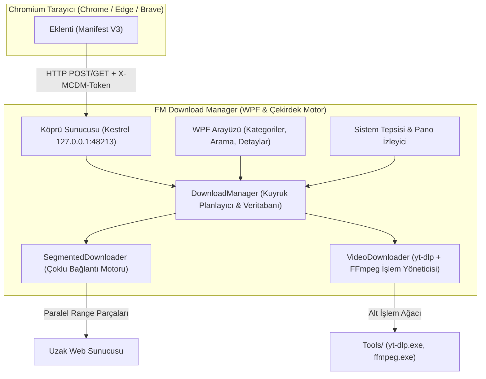

<p align="center">
  
</p>

<h1 align="center">FM Download Manager</h1>

<p align="center">
  <b>Windows 10 ve 11 için akıllı tarayıcı entegrasyonlu ve 4K video indiricili, çoklu bağlantılı yüksek hızlı indirme yöneticisi.</b><br>
  <i>(<a href="https://github.com/mstcvk">Mesut Çevik</a>'in macOS için geliştirdiği açık kaynaklı <a href="https://github.com/mstcvk/mc-download-manager">MC Download Manager</a> projesinin eksiksiz Windows portudur).</i>
</p>

<p align="center">
  <a href="https://github.com/Ferdi-krbk/fm-download-manager/releases"></a>
  <a href="https://dotnet.microsoft.com/download/dotnet/8.0"></a>
  <a href="LICENSE"></a>
  <a href="README.md"></a>
</p>

<p align="center">
  <a href="#-öne-çıkan-özellikler">Özellikler</a> •
  <a href="#-mimari">Mimari</a> •
  <a href="#-tarayıcı-entegrasyonu-ve-eşleştirme">Tarayıcı Entegrasyonu</a> •
  <a href="#-kurulum">Kurulum</a> •
  <a href="#-kaynak-koddan-derleme">Derleme</a> •
  <a href="#-sorun-giderme">Sorun Giderme</a>
</p>

---

## ⚡ Öne Çıkan Özellikler (v3.4.3)

- 🚀 **Maksimum Bant Genişliği:** Parçalı (segmented) indirme motoru (dosya başına 16 paralel bağlantıya kadar, dinamik yeniden segmentasyon).
- 🧲 **Dahili BitTorrent Motoru:** Harici istemciye gerek kalmadan magnet bağlantıları ve `.torrent` dosyalarını doğrudan çeker (MonoTorrent 3.0).
- 🎬 **YouTube 4K & Evrensel Medya:** `yt-dlp` ve `FFmpeg` motoruyla 4K60/1080p MP4 ve 320 kbps MP3 indirme garantisi (uyumsuz WebM formatlarına son).
- 🎧 **Çift Ses (Dual-Audio) Garantisi:** Rapidrame, HDFilmcehennemi ve benzeri video oynatıcılarda Türkçe Dublaj ve Orijinal ses parçalı videolarda videoyu seçilen sesle birleştirerek tam MP4 indirir (sadece ses inme hatası giderilmiştir).
- 💬 **3 Modlu Altyazı Yakalama & Otomatik VTT ➔ SRT:**
  1. *Video ile Birlikte:* Videoyu seçilen dilde altyazıyla kaydetme.
  2. *Yalnızca Altyazı (.srt):* Videoyu indirmeden doğrudan `.srt` altyazıyı çekme.
  3. *Altyazısız Ham Video:* Temiz video akışını indirme.
  *Tarayıcıda akan dinamik WebVTT altyazıları otomatik olarak VLC/TV uyumlu standart `.srt` formatına dönüştürülür.*
- 🚀 **IDM Tarzı Yüzen İndirme Çubuğu (Floating Bar):** Shadow DOM ve Trusted-Types güvenliğiyle sitelerin güvenlik politikalarına takılmadan videonun üzerine gelindiğinde anında açılan modern cam hap buton.
- 🌐 **Sıfır Tık Eklenti Eşleştirmesi:** **Chrome, Edge ve Brave** için `token.json` ile tek tıkla otomatik eşleşen tarayıcı entegrasyonu.
- 📊 **Canlı Vektör Hız Grafiği & Limit Kadranı:** WPF vektör çizimiyle anlık hız dalgalanmaları (EMA filtresi) ve indirme esnasında ayarlanabilen hız sınırlayıcı.
- ⏱️ **Gece Kuyruk Planlayıcısı:** Kotanızı korumak için gece saatlerinde otomatik başlayan zamanlayıcı.
- 🔒 **Sıfır Telemetri & Tamamen Yerel:** 256-bit eşleştirme anahtarı (`X-MCDM-Token`) ile korunan yerel köprü.

---

## 🎬 Desteklenen Platformlar & Oynatıcılar

| Platform / Oynatıcı | Video İndirme (4K/1080p MP4) | Çift Ses (Dual-Audio TR Dublaj + Orijinal) | Altyazı (.srt) Desteği | Yüzen Çubuk (Floating Bar) |
|---|:---:|:---:|:---:|:---:|
| **YouTube** | ✅ (4K60 / 1080p60 MP4) | ✅ Otomatik Eşleme | ✅ TR, EN, Otomatik (.srt) | ✅ Akıllı Hover |
| **HDFilmcehennemi** | ✅ (Full HD 1080p) | ✅ TR Dublaj / Orijinal Eşleme | ✅ VTT ➔ SRT Otomatik | ✅ Tam Uyumlu |
| **Rapidrame** | ✅ (Full HD 1080p MP4) | ✅ Çift Ses Garantili Remux | ✅ VTT ➔ SRT Otomatik | ✅ Tam Uyumlu |
| **FilmMakinesi** | ✅ (HD / Full HD) | ✅ Çoklu Ses Desteği | ✅ Türkçe / İngilizce SRT | ✅ Tam Uyumlu |
| **DiziPal** | ✅ (720p / 1080p) | ✅ Orijinal + Dublaj | ✅ Gömülü & Ağ Altyazıları | ✅ Tam Uyumlu |
| **Closeload / Vidmoly** | ✅ (Hızlı Akış) | ✅ Tek / Çift Ses | ✅ SRT İndirme | ✅ Tam Uyumlu |
| **Twitter/X & TikTok** | ✅ (En Yüksek Çözünürlük) | ✅ Dahili Ses | — | ✅ Anında Hover |
| **1000+ Popüler Web Sitesi** | ✅ (`yt-dlp` Entegrasyonu) | ✅ Tüm Ses Akışları | ✅ Tüm Altyazı Parçaları | ✅ Genel Yakalayıcı |

---

## 📸 Arayüz & Yetenekler

### 🗂️ Akıllı Kategori Ayrımı ve Arama
İndirilen dosyalar dosya türüne göre otomatik olarak ayrılır (*Tümü, Resimler, Müzik, Video, Programlar, Belgeler, Arşivler, Diğer*). Anlık arama kutusu ve sıralanabilir sütunlar içerir.

### 💬 Evrensel Altyazı Dönüştürücü (VTT ➔ SRT)
Tarayıcı oynatıcılarında kullanılan WebVTT altyazılarını arka planda temizler; zaman kodlarını, renk ve stil etiketlerini standart SubRip formatına dönüştürerek televizyon, VLC ve telefonlarda Türkçe karakter sorunu olmadan altyazılı izlemenizi sağlar.

### 📊 Bağlantı ve Parça Görselleştirici (IDM Tarzı)
Her bir parçanın bayt aralığını, indirilme yüzdesini ve anlık transfer hızını detaylı pencerede inceleyin.

```
┌────────────────────────────────────────────────────────────────────────┐
│  İndirilen: arsiv-yedek.zip (2.4 GB)                                   │
├────────────────────────────────────────────────────────────────────────┤
│  [=====================================>         ] %78 (18.4 MB/sn)    │
│                                                                        │
│  Parça 1:  [====================] %100 (300 MB / 300 MB)               │
│  Parça 2:  [====================] %100 (300 MB / 300 MB)               │
│  Parça 3:  [==============>     ]  %72 (216 MB / 300 MB)               │
│  Parça 4:  [===========>        ]  %55 (165 MB / 300 MB)               │
└────────────────────────────────────────────────────────────────────────┘
```

### 📋 Otomatik Pano Algılama
Panoya bir `http(s)` dosya bağlantısı kopyalandığında FM Download Manager sağ altta zarif bir onay kutusu çıkartarak indirmek isteyip istemediğinizi sorar.

### 🌐 Sistem Tepsisi (Tray) Bildirimleri
- Pencere kapatıldığında arka planda tepside çalışmaya devam eder.
- Tepsi simgesi üzerine gelindiğinde anlık indirme hızı ve aktif indirme sayısı görüntülenir.
- İndirme tamamlandığında yerel Windows bildirimi gösterilir.

---

## 🏗️ Mimari



---

## 🔌 Tarayıcı Entegrasyonu ve Eşleştirme

FM Download Manager, **Google Chrome, Microsoft Edge ve Brave** tarayıcıları için hazır Manifest V3 eklentisiyle birlikte gelir.

```
  1. FM Download Manager'ı açın
       ↓
  2. Araç çubuğunda "Tarayıcı kurulumu" butonuna tıklayın
       ↓
  3. "Eklenti klasörünü aç" butonuna tıklayın
       ↓
  4. Tarayıcıda: Uzantılar (chrome://extensions) → "Geliştirici modu"nu açın → "Paketlenmemiş öge yükle"
       ↓
  5. Eklenti simgesine tıklayın → Eşleştirme kodunu yapıştırın → Tamamlandı (✓ Eşleşti)
```

---

## 📥 Kurulum

### Yöntem 1: Hazır Kurulum Programı (Önerilen)
[GitHub Releases](https://github.com/Ferdi-krbk/fm-download-manager/releases) sayfasından en güncel `FMDownloadManager-Setup-3.4.0.exe` dosyasını indirin.
- Yönetici izni gerekmeden doğrudan `%LOCALAPPDATA%\Programs\FM Download Manager` dizinine yüklenir.
- Masaüstü ve Başlat menüsü kısayollarını otomatik yapılandırır.

### Yöntem 2: Taşınabilir (Portable)
Tek dosya olarak yayımlanan bağımsız `.exe` dosyasını indirip kurulum yapmadan doğrudan çalıştırabilirsiniz.

---

## 🛠️ Kaynak Koddan Derleme

### Gereksinimler
- Windows 10 (1809+) veya Windows 11 (x64)
- [.NET 8.0 SDK](https://dotnet.microsoft.com/download/dotnet/8.0)
- Inno Setup 6 (kurulum paketi derlemek için)

### Komutlar

```powershell
# Depoyu klonlayın
git clone https://github.com/Ferdi-krbk/fm-download-manager.git
cd fm-download-manager

# Projeyi derleyin
dotnet build -c Release

# 20 adet otomatik entegrasyon testini çalıştırın
dotnet run -c Release --project tests/McDm.Tests

# Bağımsız tek dosya olarak yayınlayın
dotnet publish src/McDm.App/McDm.App.csproj -c Release -r win-x64 --self-contained true -p:PublishSingleFile=true -o publish/win-x64

# (İsteğe bağlı) Resmi yt-dlp ve FFmpeg araçlarını indirin
powershell -ExecutionPolicy Bypass -File scripts/fetch-tools.ps1

# (İsteğe bağlı) Inno Setup kurulum paketini derleyin (Inno Setup 6 kuruluysa)
iscc installer\setup.iss
```

---

## 📄 Lisans ve Atıf

- Bu proje **MIT Lisansı** altında yayımlanmıştır.
- Upstream macOS projesi olan [mstcvk/mc-download-manager](https://github.com/mstcvk/mc-download-manager) temel alınarak Windows'a uyarlanmıştır.
- Paketle birlikte sağlanan üçüncü taraf araçlar (FFmpeg ve yt-dlp) kendi lisanslarına tabidir (LGPL/GPL ve Unlicense). Ayrıntılar için [NOTICE.md](NOTICE.md) dosyasına bakabilirsiniz.
