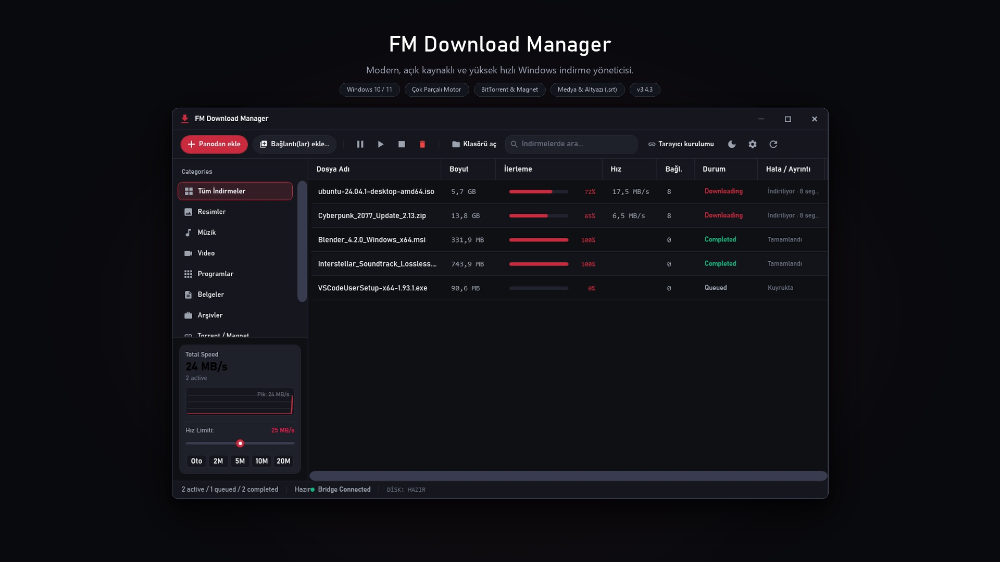
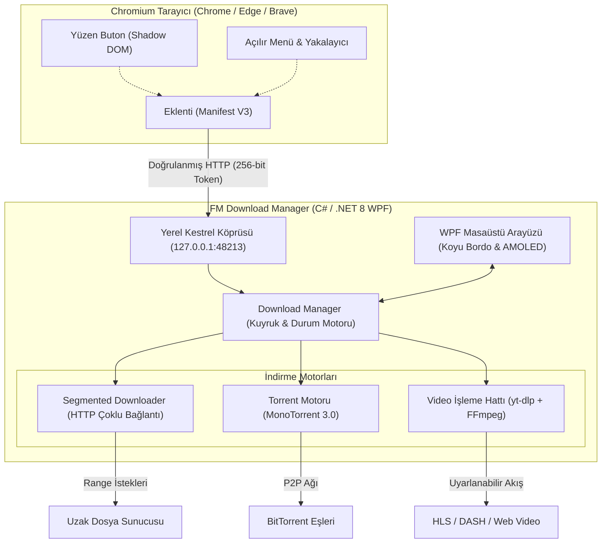

<p align="center">
  
</p>

<h1 align="center">FM Download Manager</h1>

<p align="center">
  <b>Windows 10 ve 11 için modern, hafif ve yüksek performanslı indirme yöneticisi.</b><br>
  <i>Dinamik parçalı indirme motoru, dahili BitTorrent istemcisi, akıllı medya yakalayıcı ve IDM tarzı yüzen kontroller.</i>
</p>

<p align="center">
  <a href="https://github.com/Ferdi-krbk/fm-download-manager/releases"></a>
  <a href="https://dotnet.microsoft.com/download/dotnet/8.0"></a>
  <a href="https://github.com/Ferdi-krbk/fm-download-manager"></a>
  <a href="https://github.com/Ferdi-krbk/fm-download-manager"></a>
  <a href="LICENSE"></a>
  <a href="README.md"></a>
</p>

<p align="center">
  <a href="#-genel-bakış">Genel Bakış</a> •
  <a href="#-temel-özellikler">Temel Özellikler</a> •
  <a href="#-desteklenen-medya--akış-protokolleri">Desteklenen Medya</a> •
  <a href="#-mimari">Mimari</a> •
  <a href="#-kurulum">Kurulum</a> •
  <a href="#-klavye-kısayolları">Kısayollar</a> •
  <a href="#-kaynak-koddan-derleme">Derleme</a>
</p>

---

<p align="center">
  
</p>

---

## 📌 Genel Bakış

**FM Download Manager**, Windows işletim sistemi için C# / WPF ve **.NET 8** ile sıfırdan geliştirilmiş, açık kaynaklı bir masaüstü indirme istasyonudur. Eski nesil, reklam dolu ve hantal yazılımların yerine; doğrudan dosya transfer hızına, düşük kaynak tüketimine ve güvenli tarayıcı entegrasyonuna odaklanır.

* **Tamamen Yerel & Gizlilik Odaklı:** Sıfır telemetri, sıfır reklam, sıfır harici bulut bağımlılığı.
* **Modern Windows Arayüzü:** Donanım hızlandırmalı WPF, net Bahnschrift tipografisi ve çift karanlık tema (Koyu Bordo ve AMOLED Derin Siyah).
* **Güvenli Yerel Köprü:** Chromium tabanlı tarayıcılarla (Chrome, Edge, Brave) 256-bit token doğrulamalı yerel HTTP köprüsü (`127.0.0.1:48213`) üzerinden haberleşir.

---

## ⚡ Temel Özellikler

### 1. Dinamik Yeniden Segmentasyon Motoru
Geleneksel parçalı indiriciler dosyayı sabit bloklara böler. Bir iş parçacığı yavaşladığında veya takıldığında indirme tamamlanamaz. FM Download Manager parçaların anlık durumunu izler: erken biten bir iş parçacığı, en yavaş ilerleyen parçayı dinamik olarak ortadan ikiye bölerek kalan yarısını paralel indirmeye başlar. Bu sayede bant genişliği son bayta kadar dengeli kullanılır.

### 2. Entegre BitTorrent & Magnet İstemcisi
Güçlü **MonoTorrent 3.0** kütüphanesi üzerine inşa edilmiştir:
* Harici bir torrent istemcisine (uTorrent, qBittorrent vb.) ihtiyaç duymadan doğrudan `magnet:?xt=urn:btih:...` bağlantılarını ve `.torrent` dosyalarını indirir.
* Dağıtık Karma Tablosu (DHT), Eş Değişimi (PEX), Yerel Eş Keşfi (LSD) ve şifreli veri aktarım protokollerini tam destekler.

### 3. Akıllı Medya Yakalama & Garantili MP4 Çıktısı
Gömülü `yt-dlp` ve `FFmpeg` işleme hattı ile donatılmıştır:
* YouTube, Twitter/X, TikTok, Instagram, Reddit, Vimeo, Facebook ve 1000'den fazla siteden tek tıkla video yakalama.
* **Temiz MP4 Dönüştürme:** Yüksek çözünürlüklü video ve ses parçaları otomatik olarak evrensel `.mp4` formatında birleştirilir (oynatma sorunu çıkaran uyumsuz WebM dosyaları oluşturulmaz).
* **Kalite ve Biçim Seçici:** *En Yüksek Kalite (4K60 / 1080p60)*, *720p HD* veya doğrudan *Yalnızca Ses Çıkar (MP3 / 320 kbps)* seçenekleri sunar.

### 4. Çift Ses (Dual-Audio) & Çoklu Parça Eşleme
Web oynatıcılarında sunulan uyarlanabilir HLS (`.m3u8`) veya DASH (`.mpd`) yayınlarında sıkça karşılaşılan Türkçe Dublaj ve Orijinal ses parçaları:
* Video indiricilerin sadece ~20 MB'lık izole ses dosyasını indirmesi hatasını tamamen çözer.
* Seçilen görüntü çözünürlüğü ile istenen ses parçasını otomatik olarak eşleştirir ve eksiksiz, yüksek kaliteli bir video dosyası olarak kaydeder.

### 5. Evrensel Altyazı Yakalama & VTT ➔ SRT Dönüştürücü
Gömülü ve harici altyazılar üzerinde tam kontrol:
* **3 Farklı İndirme Modu:**
  1. *Video + Altyazı:* Videoyu seçtiğiniz altyazı diliyle birlikte eş zamanlı indirme.
  2. *Yalnızca Altyazı (`.srt`):* Videoyu indirmeden doğrudan `.srt` altyazı dosyasını saniyeler içinde kaydetme.
  3. *Temiz Video:* Altyazısız ham video akışını indirme.
* **Otomatik WebVTT ➔ SubRip (.srt) Dönüştürme:** Web oynatıcılarının sunduğu ham `.vtt` akışlarını zaman damgası ve etiket temizliğinden geçirerek VLC, televizyonlar ve telefonlarla tam uyumlu standart `.srt` dosyalarına dönüştürür.

### 6. IDM Tarzı Modern Yüzen İndirme Çubuğu (Floating Bar)
* **Shadow DOM İzolasyonu:** Sayfa stillerinden ve sitelerin güvenlik politikalarından etkilenmeyen bağımsız modern cam tasarım.
* **Trusted Types & CSP Uyumluluğu:** Saf DOM element inşasıyla YouTube gibi modern platformların katı CSP güvenlik politikalarını hatasız karşılar.
* **Pürüzsüz Hover:** Farenizi bir video oynatıcısının veya gömülü çerçevenin (iframe) üzerine getirdiğiniz anda sağ üst köşede belirir.

### 7. Bant Genişliği Yönetimi & Vektör Hız Grafiği
* **Canlı Vektör Dalga Formu:** Ağ dalgalanmalarını pürüzsüzleştiren Exponential Moving Average (EMA) filtreli gerçek zamanlı hız grafiği.
* **Anlık Hız Sınırlayıcı:** İndirmeyi duraklatmadan kaydırıcı veya hazır butonlar (`[Oto] [2M] [5M] [10M] [20M]`) üzerinden bant genişliği sınırı tanımlama.
* **Gece Kuyruk Planlayıcısı:** Kotanızı korumak için indirmeleri gece saatlerinde (örn. 02:00 – 07:00) otomatik başlatıp durdurma.

---

## 🎬 Desteklenen Medya & Akış Protokolleri

| Kategori | Desteklenen Kaynak & Formatlar | Yetenekler |
|---|---|---|
| **Popüler Video Siteleri** | YouTube, Twitter/X, TikTok, Instagram, Reddit, Vimeo, Facebook | 4K60 HDR'a kadar, MP3 320k, Altyazı çekme, Anında yüzen buton |
| **3. Parti Web Oynatıcıları** | HLS (`.m3u8`), DASH (`.mpd`), doğrudan MP4/WebM gömülü yayınlar | Çift Ses / Dual-Audio (Dublaj + Orijinal) eşleme, çözünürlük seçimi |
| **Altyazı Biçimleri** | WebVTT (`.vtt`), SubRip (`.srt`), Oynatıcı Metin Akışları | Otomatik VTT ➔ SRT çevirimi, çoklu dil seçimi, bağımsız altyazı alma |
| **BitTorrent** | Magnet URI bağlantıları, `.torrent` meta dosyaları | Çok dosyalı torrentler, DHT/PEX, şifreli eşler arası aktarım |
| **Doğrudan Web İndirmeleri** | HTTP/1.1, HTTP/2, Parçalı (Range) dosya sunucuları | Dinamik çoklu bağlantı (16 iş parçacığı), otomatik devam etme |

---

## 🏗️ Mimari



---

## 📦 Kurulum

### Yöntem 1: Windows Kurulum Paketi (Önerilen)
1. [En Son Sürümler (Releases)](https://github.com/Ferdi-krbk/fm-download-manager/releases) sayfasından `FMDownloadManager-Setup-3.4.3.exe` dosyasını indirin.
2. Kurulum dosyasını çalıştırın. Program `%LOCALAPPDATA%\Programs\FM Download Manager` dizinine yönetici yetkisi gerektirmeden yüklenir.
3. Kurulum tamamlandığında tarayıcı eklentisi klasörü ve kurulum kılavuzu otomatik olarak açılır.

### Yöntem 2: Tarayıcı Eklentisi Kurulumu
1. Google Chrome, Microsoft Edge veya Brave tarayıcınızda `chrome://extensions` sayfasına gidin.
2. Sağ üst köşedeki **Geliştirici Modu** anahtarını açın.
3. **Paketlenmemiş öge yükle** butonuna tıklayın ve program klasöründeki `extension` dizinini seçin.
4. Eklenti yerel köprü anahtarını otomatik tanır ve yeşil renkle eşleşir.

---

## ⌨️ Klavye Kısayolları

| Kısayol | İşlev |
|---|---|
| `Ctrl + N` | Yeni indirme bağlantısı ekle (Dosya, Medya veya Magnet) |
| `Ctrl + V` | Panodaki bağlantıyı otomatik yapıştır |
| `Ctrl + F` | Hızlı arama kutusuna odaklan |
| `Space` | Seçili indirmeyi duraklat veya devam ettir |
| `Delete` | Seçili görevi listeden kaldır |
| `Shift + Delete` | Görevi listeden kaldır ve indirilen dosyayı diskten sil |
| `Ctrl + Shift + T` | Koyu Bordo ve Derin AMOLED Siyah temaları arasında geçiş yap |
| `Ctrl + ,` | Ayarlar penceresini aç |

---

## 🛠️ Kaynak Koddan Derleme

### Gereksinimler
* Windows 10 veya 11 (x64)
* [.NET 8.0 SDK](https://dotnet.microsoft.com/download/dotnet/8.0)
* Git for Windows

```bash
# Depoyu klonlayın
git clone https://github.com/Ferdi-krbk/fm-download-manager.git
cd fm-download-manager

# Bağımlılıkları geri yükleyin ve derleyin
dotnet restore
dotnet build -c Release

# Otomasyon testlerini çalıştırın
node tests/test_full_download_matrix.js
dotnet test tests/McDm.Tests/McDm.Tests.csproj

# Uygulamayı başlatın
dotnet run --project src/McDm.App/McDm.App.csproj
```

---

## 📄 Lisans & Teşekkür

* **Lisans:** Bu proje [MIT Lisansı](LICENSE) kapsamında açık kaynak olarak sunulmaktadır.
* **Köken:** [Mesut Çevik](https://github.com/mstcvk) tarafından macOS için geliştirilen açık kaynaklı [MC Download Manager](https://github.com/mstcvk/mc-download-manager) projesinden esinlenilmiş; Windows mimarisi için baştan modellenmiştir.
* **Kullanılan Çekirdek Kütüphaneler:** [.NET 8](https://github.com/dotnet), [MonoTorrent](https://github.com/alanmcgovern/monotorrent), [yt-dlp](https://github.com/yt-dlp/yt-dlp) ve [FFmpeg](https://ffmpeg.org/).
