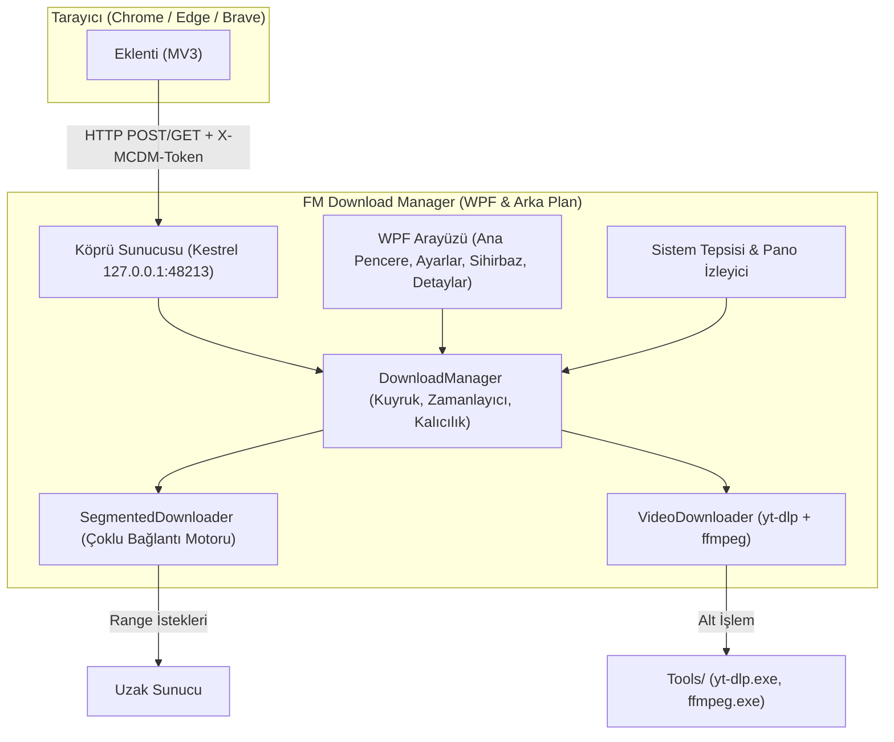

# FM Download Manager (Windows Sürümü)

> Windows 10/11 için tarayıcı entegrasyonuna ve video indirme yeteneğine sahip, hızlı, hafif ve çoklu bağlantılı indirme yöneticisi (C# / .NET 8).
>
> *(macOS [mstcvk/mc-download-manager](https://github.com/mstcvk/mc-download-manager) açık kaynak projesinden Windows'a uyarlanmıştır, MIT Lisansı).*

---

## Özellikler

- **Çoklu Bağlantılı Parçalı İndirme Motoru (`McDm.Core`):**
  - HTTP Range tabanlı paralel parça indirme (1–16 bağlantı, varsayılan 8).
  - Sunucudan `429 Too Many Requests` veya `503 Service Unavailable` yanıtı geldiğinde bağlantı havuzunu dinamik olarak daraltma ve yeniden deneme.
  - Duraklatma ve devam ettirme (atomik `.mcdm` durum dosyalarıyla uygulama kapansa veya PC yeniden başlasa bile devam eder).
  - Sunucu dosya ETag değerini değiştirirse eski durumu temizleyip otomatik olarak sıfırdan başlama.
  - Güvenli yönlendirme (farklı alan adlarına yönlendirmede çerezleri temizleme).
  - Dosya adı temizleme, dizin atlama (path traversal) koruması ve aynı isimli dosyalarda çakışma önleme.
  - Global hız sınırlayıcı (KB/s, token-bucket algoritması).
  - Dosya ayrılmadan önce disk boş alan kontrolü.
  - Antivirüs veya dizinleyici kilitlerine karşı yeniden deneme mekanizması.

- **Tarayıcı Entegrasyonu (Chrome, Edge, Brave):**
  - Tarayıcı indirmelerini iptal edip çerezler, Referer ve User-Agent bilgileriyle uygulamaya yönlendirme.
  - Yalnızca yerel ağ dinleyen (`127.0.0.1:48213`), **rastgele eşleştirme anahtarı** (`X-MCDM-Token`) ile korunan HTTP köprüsü.
  - Yakalanacak dosya uzantıları ve minimum dosya boyutu eşiği belirleme.
  - Tek tıkla eklenti klasörünü açan ve eşleştirme kodunu kopyalayan **Tarayıcı Kurulum Sihirbazı**.

- **Video İndirme (`yt-dlp` + `FFmpeg`):**
  - Web sayfalarından 4K'ya kadar MP4/MKV formatında video indirme.
  - Güvenli child process yürütme (`ArgumentList` ile komut satırı enjeksiyonuna kapalı).
  - Gerçek zamanlı ilerleme takibi, duraklatma ve iptal desteği.
  - SHA-256 doğrulayıcı içeren resmi araç indirme betiği (`scripts/fetch-tools.ps1`).

- **Modern WPF Masaüstü Uygulaması (`McDm.App`):**
  - Anlık hız gösteren ve indirme tamamlandığında bildirim veren sistem tepsisi simgesi.
  - Sistem tepsisine küçülme ve tekil çalışma (single-instance) denetimi.
  - Kenar çubuğu kategorileri: *Tümü, Resimler, Müzik, Video, Programlar, Belgeler, Arşivler, Diğer*.
  - Arama filtresi ve IDM tarzı bağlantı/parça ilerleme detay penceresi.
  - Panodaki indirme bağlantılarını otomatik algılayan pano izleyicisi.
  - `.resx` kaynakları üzerinden eksiksiz Türkçe ve İngilizce dil desteği.

---

## Mimari



---

## Köprü API Sözleşmesi

Yerel köprü `127.0.0.1:48213` üzerinde çalışır. `OPTIONS` ve kimliksiz `/ping` dışındaki tüm uç noktalarda eşleştirme anahtarı zorunludur:

| Metot | Uç Nokta | Gerekli Başlıklar | Açıklama |
|---|---|---|---|
| `GET` | `/ping` | *(yok)* | Yalın `{ name, platform, version, paired: false }` döner. |
| `GET` | `/ping` | `X-MCDM-Token` | `paired: true`, `ytDlpAvailable`, indirme sayısı ve ayarları içeren tam durum döner. |
| `GET` | `/downloads` | `X-MCDM-Token` | Son indirmeleri ve durumlarını listeler. |
| `POST` | `/download` | `X-MCDM-Token` | İndirme ekler (`url`, `fileName`, `referer`, `cookies`, `kind`). |
| `POST` | `/action` | `X-MCDM-Token` | Kuyruk eylemleri: `pause`, `resume`, `cancel`, `remove`. |

---

## Tarayıcı Eklentisi Kurulumu ve Eşleştirme

1. **FM Download Manager** uygulamasını başlatın.
2. Araç çubuğundaki **Tarayıcı kurulumu** butonuna tıklayın.
3. **Eklenti klasörünü Dosya Gezgini'nde aç** butonuna tıklayarak `extension/` klasörünü açın.
4. Tarayıcınızda `chrome://extensions` (veya `edge://extensions` / `brave://extensions`) adresine gidin.
5. **Geliştirici modu**nu etkinleştirip **Paketlenmemiş öge yükle** seçeneğiyle açılan klasörü seçin.
6. Tarayıcı araç çubuğundaki FM Download Manager simgesine tıklayın.
7. Uygulamadaki **Eşleştirme kodunu kopyala** butonuna basıp kodu eklenti kutucuğuna yapıştırın ve **Eşleştir**e tıklayın.
8. Eklenti **Eşleşti ✓** durumuna geçecek ve indirmeleri otomatik olarak yakalayacaktır!

---

## Kaynak Koddan Derleme

### Gereksinimler
- Windows 10 (1809+) veya Windows 11 (x64)
- .NET 8.0 SDK

### Komutlar

```powershell
# 1. Geri Yükle ve Derle
dotnet build -c Release

# 2. Tüm 20 Testi Çalıştır
dotnet run -c Release --project tests/McDm.Tests

# 3. Bağımsız Tek Dosya Yayınla
dotnet publish src/McDm.App/McDm.App.csproj -c Release -r win-x64 --self-contained true -p:PublishSingleFile=true -o publish/win-x64

# 4. yt-dlp & FFmpeg Araçlarını Çek (Video İndirmeleri İçin)
powershell -ExecutionPolicy Bypass -File scripts/fetch-tools.ps1

# 5. Inno Setup Kurulum Paketini Derle
& "C:\Users\Ferdi\AppData\Local\Programs\Inno Setup 6\ISCC.exe" installer\setup.iss
```

Oluşan kurulum programı `dist/FMDownloadManager-Setup-0.1.0.exe` konumunda yer alacaktır.

---

## Bilinen Kısıtlamalar

- **Firefox Eklentisi:** Firefox imzalanmamış uzantıların kalıcı yüklenmesine kısıtlama getirdiği için Chromium tabanlı tarayıcılar (Chrome, Edge, Brave) doğrudan desteklenmektedir.
